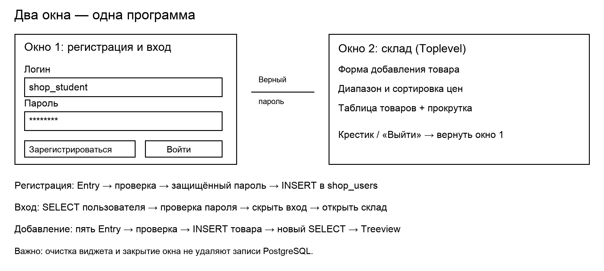
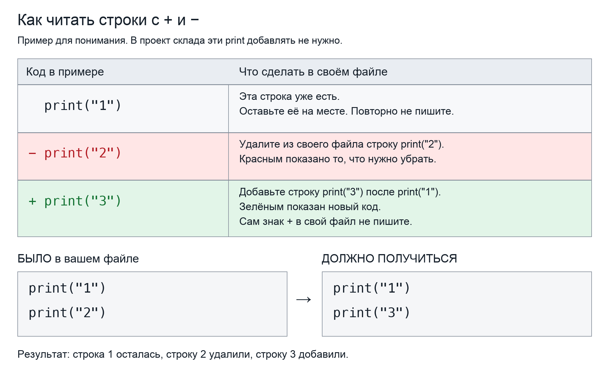
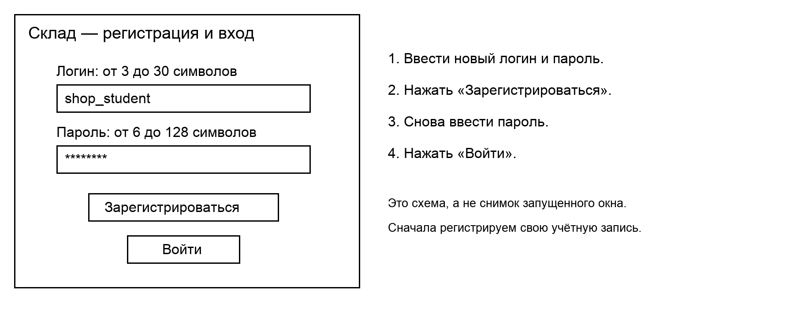
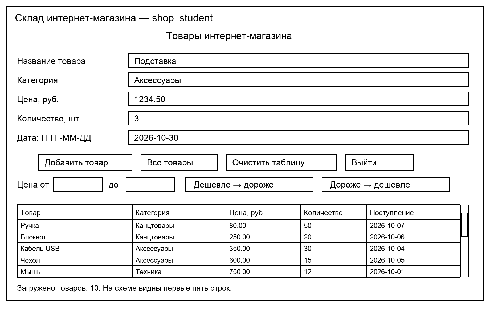

# Собираем склад интернет-магазина: от первой надписи до работающего приложения

## Какой результат получим

Сначала человек регистрируется: вводит свой логин и пароль. Потом входит. При правильном пароле открывается **новое окно склада**, а окно входа скрывается. На складе можно увидеть товары из PostgreSQL, добавить новый товар, выбрать диапазон цен и расположить товары от дешёвых к дорогим или наоборот. Кнопка «Выйти» и крестик склада возвращают ко входу.

Пишем без собственных классов: обычные команды, виджеты и функции. Одно главное окно `Tk`, одно дополнительное `Toplevel`, один цикл `mainloop`. Не строим новый проект для каждого шага: все детали постепенно добавляются в один файл `shop.py`.



Изображения — чёрно-белые учебные схемы. Они показывают расположение и связь элементов, а не точный внешний вид на каждой операционной системе.

## Сначала разложите файлы по местам

Создайте **свою папку проекта**, например `Мой_склад`, и откройте именно её в редакторе. Итоговая структура вашей работы:

```text
Мой_склад/
├── shop.py                 ← основной код: набираете по шагам Python-1…Python-10
├── settings.py             ← настройки: создаёте один раз перед Python-1
├── password_tools.py       ← готовый файл: копируете из учебного комплекта
└── sql/                    ← создаёте папку для своих SQL-файлов
    ├── 00_check_connection.sql
    ├── 00_database_if_needed.sql  ← только если базы ещё нет
    ├── 01_users.sql
    ├── 02_products.sql
    ├── 03_products_seed.sql
    ├── 04_check.sql
    └── 05_find_product.sql
```

**Разбор обозначений в собранном примере:**

- `Мой_склад/` — ваша папка проекта. Символ `/` в схеме показывает папку; его не добавляют к имени при создании.
- `├──`, `└──`, `│` и стрелки — линии рисунка. Это не команды и не части имён файлов.
- `.py` — расширение файла Python; `.sql` — расширение файла с SQL-командами.
- `shop.py` — основной файл, который запускаем. `settings.py` — настройки, которые основной файл читает через import.
- `password_tools.py` — готовые функции для работы с паролями. `sql` — папка, в которой сохраняем свои SQL-файлы.
- Цифры в начале SQL-имён нужны для удобного порядка файлов. Они не выполняют команды автоматически.


**README.md — инструкция для чтения. В сам README код программы не дописывают.** Он может оставаться в папке учебного комплекта. Все Python-файлы вашей программы должны лежать рядом друг с другом.

Три места работы:

- **Редактор → shop.py:** окно, виджеты, функции и привязки кнопок.
- **Редактор → settings.py:** настройки подключения. Возьмите файл `settings_example.py` из комплекта, скопируйте в свою папку проекта и переименуйте эту копию в `settings.py`. Подробный порядок действий дан в разделе «Настройки settings.py». Файл в исходном комплекте удалять не нужно.
- **pgAdmin → Query Tool:** выполняете SQL. Свои SQL-команды сохраняете в указанные файлы папки sql. Сохранить файл и выполнить его — разные действия.

Команды `python3 ...` вводятся **в терминале**, открытом в папке `Мой_склад`. Для запуска используйте `python3 shop.py`. Не вставляйте команду запуска в shop.py или в Query Tool.

## Какие строки нужно дописывать

Посмотрите на простой пример: слева код, справа — что с ним сделать.



В примере было две строки: `print("1")` и `print("2")`. Первую оставили, вторую удалили, а вместо неё добавили `print("3")`.

**В следующих шагах действуйте так же:** зелёные строки с `+` дописывайте, красные с `-` удаляйте, остальные оставляйте на месте. Знаки `+` и `-` в файл не переносите. Отступы кода сохраняйте.

Это только пример чтения инструкции — **print в программу склада добавлять не нужно**. В каждом шаге ниже подписано имя файла и место добавления новых строк.

Код теперь разделён на маленькие действия. Под Python-примерами есть пояснения к новым строкам. Под SQL-командой — разбор её слов и знаков. Строки без `+` показаны только для места вставки.

## Правила сборки

1. Создайте отдельную папку проекта и откройте её в редакторе.
2. В эту папку положите `password_tools.py` из учебного комплекта — это готовый вспомогательный модуль для паролей. Его не нужно переписывать наизусть.
3. Создайте `settings.py` по шагу ниже.
4. Создайте пустой `shop.py` и набирайте фрагменты раздела «Сборка Python» строго сверху вниз.
5. В шаге Python-2 добавьте `окно.mainloop()` — эта строка уже показана со знаком +. Далее она остаётся последней; следующие изменения вставляются перед ней. Второй раз mainloop не добавляйте.
6. Сохраняйте отступы. Строка `def` начинается от левого края; её тело — с четырёх пробелов; вложенные блоки — ещё на четыре глубже.
7. Закончив шаг целиком, сохраните файл, закройте прежнее окно и запустите файл заново. В середине набора функции или SQL-команды запускать ещё рано.

Добавляйте код по порядку. После завершения шага выполните указанную проверку. Маленькие части внутри него сначала соберите целиком.

## Подготовка Python: сначала проверка, установка только при необходимости

**Не выполняйте все команды подряд.** Выберите путь по результату проверки:

- **Вариант 1 — рабочее место уже настроено:** выполните проверки из варианта 1. Если они прошли, ничего устанавливать не нужно — переходите к сборке базы данных.
- **Вариант 2 — чего-то не хватает:** выполните только подходящий пункт варианта 2, затем повторите соответствующую проверку.

Все команды этого раздела вводятся **в терминале**, а не в shop.py и не в Query Tool pgAdmin. Выполняйте их по одной: прочитайте результат перед следующей командой.

Если на вашем компьютере Python запускается командой `python`, используйте `python` вместо `python3` во всех командах инструкции. Устанавливать пакет и запускать проект нужно одним и тем же Python. В редакторе должен быть выбран этот же интерпретатор.

### Вариант 1. Только проверить — ничего не устанавливаем

**Проверка 1. Работает ли Python?**

```bash
python3 --version
```

**Разбор обозначений в собранном примере:**

- `python3` — запустить Python 3, установленный на компьютере.
- `--version` — попросить показать номер версии и завершить команду. Два дефиса входят в имя этого параметра.
- Пробел отделяет имя программы от её параметра. Эта команда не создаёт файл и ничего не устанавливает.


Ожидается строка вида `Python 3.x.x`. Эта команда только показывает версию, не устанавливает Python. Если команда не найдена, перейдите к пункту «Не запускается Python» в варианте 2.

**Проверка 2. Работают ли окна Tkinter?**

```bash
python3 -m tkinter
```

**Разбор обозначений в собранном примере:**

- `python3` — используемый Python.
- `-m` — запустить модуль по имени. Модуль — библиотека Python.
- `tkinter` — имя встроенной библиотеки окон. При таком запуске она открывает своё проверочное окно.
- Если вместо tkinter написать другое имя, Python попробует запустить другой модуль. Для проверки окна оставьте tkinter.


Ожидается небольшое демонстрационное окно. Закройте его, затем продолжайте. Эта команда запускает проверочное окно, а не устанавливает Tkinter. Если появляется ошибка об отсутствии tkinter или _tkinter, смотрите соответствующий пункт варианта 2.

**Проверка 3. Доступна ли библиотека Psycopg 3?**

```bash
python3 -c "import psycopg; print(psycopg.__version__)"
```

**Разбор обозначений в собранном примере:**

- `python3` — используемый Python.
- `-c` — выполнить небольшой текст Python-кода прямо из команды терминала.
- Двойные кавычки объединяют весь текст `import ...; print(...)` в один аргумент команды. Они не входят в исполняемый Python-код.
- `import psycopg` — подключить библиотеку PostgreSQL. Если она не найдена, проверка завершится ошибкой.
- `;` внутри кавычек разделяет здесь две Python-команды, записанные в одной строке.
- `psycopg.__version__` — значение с номером версии библиотеки. Точка обращается к части библиотеки; двойные подчёркивания входят в готовое имя __version__, убирать их нельзя.
- `print(...)` — вывести значение в терминал. Круглые скобки содержат то, что печатаем.


Ожидается номер версии: например, `3.3.5`. Для этого урока подходит Psycopg версии **от 3.2 включительно до 4 не включительно**. Эта команда только пробует импортировать библиотеку и показывает её версию. Ничего не устанавливается.

Если видите `ModuleNotFoundError: No module named 'psycopg'`, выполните установку из варианта 2. Если версия не подходит или появляется другая ошибка загрузки Psycopg, покажите сообщение преподавателю: не запускайте установку многократно наугад.

**Все три проверки прошли? Подготовка завершена. Команду pip install пропустите и переходите к разделу «Сборка базы данных». При каждом запуске shop.py заново устанавливать библиотеку не нужно.**

### Вариант 2. Подготовить то, чего не хватает

**А. Не запускается Python**

Если `python3 --version` не сработала, сначала уточните команду запуска и установку Python у преподавателя. Команда pip устанавливает дополнительные пакеты **для уже существующего Python**, а не сам Python. Пока интерпретатор не запускается, к установке Psycopg не переходите.

**Б. Python есть, но нет Tkinter / _tkinter**

Требуется Python с поддержкой Tcl/Tk. Попросите преподавателя настроить учебную установку Python. Команду `pip install tkinter` вводить не нужно: она не является способом исправления отсутствующего _tkinter в этом проекте. После настройки повторите `python3 -m tkinter`.

**В. Python и Tkinter работают, но Psycopg отсутствует**

Только в этом случае выполните команду установки:

```bash
python3 -m pip install "psycopg[binary]>=3.2,<4"
```

**Разбор обозначений в собранном примере:**

- `python3 -m pip` — запустить pip, установщик библиотек, через выбранный Python.
- `install` — действие pip: установить пакет.
- `psycopg` — имя пакета для PostgreSQL.
- `[binary]` — дополнительный вариант установки с готовой двоичной сборкой. Квадратные скобки здесь — часть записи для pip, а не Python-список.
- `>=3.2` — версия не ниже 3.2; `<4` — версия ниже 4. Запятая объединяет два ограничения.
- Кавычки передают всю запись пакета одним аргументом и не дают терминалу трактовать символы `<` и `>` как свои команды.
- Это команда установки, поэтому её выполняем только при необходимости.


Что означает команда:

- `python3 -m pip` — запустить установщик пакетов именно выбранного Python;
- `install` — установить пакет;
- `psycopg` — библиотека для подключения Python к PostgreSQL;
- `[binary]` — использовать готовую двоичную сборку, чтобы не собирать библиотеку самостоятельно;
- `>=3.2,<4` — допустимый диапазон версий для урока;
- кавычки сохраняют запись пакета с условиями как один аргумент команды.

После установки **проверьте результат**, а не запускайте установку повторно:

```bash
python3 -c "import psycopg; print(psycopg.__version__)"
```

**Разбор обозначений в собранном примере:**

- `python3` — используемый Python.
- `-c` — выполнить небольшой текст Python-кода прямо из команды терминала.
- Двойные кавычки объединяют весь текст `import ...; print(...)` в один аргумент команды. Они не входят в исполняемый Python-код.
- `import psycopg` — подключить библиотеку PostgreSQL. Если она не найдена, проверка завершится ошибкой.
- `;` внутри кавычек разделяет здесь две Python-команды, записанные в одной строке.
- `psycopg.__version__` — значение с номером версии библиотеки. Точка обращается к части библиотеки; двойные подчёркивания входят в готовое имя __version__, убирать их нельзя.
- `print(...)` — вывести значение в терминал. Круглые скобки содержат то, что печатаем.


Появился подходящий номер версии — готово. Если видите `Requirement already satisfied`, pip сообщает, что подходящий пакет уже установлен; это не ошибка и не повод повторять команду.

Если Python запрещает системную установку библиотек или pip не запускается, покажите сообщение преподавателю. Используйте подготовленный интерпретатор или учебное виртуальное окружение; не обходите ограничения случайными командами.

**Нужно ли устанавливать что-нибудь ещё?** Модули `decimal`, `datetime`, `hashlib`, `hmac` и `secrets` входят в стандартную библиотеку Python. Их через pip не устанавливают. `settings.py` и `password_tools.py` — файлы нашего проекта, а не пакеты для установки. Сам сервер PostgreSQL и pgAdmin подготавливаются отдельно; установка Psycopg их не устанавливает.

**Запомните:** проверка выясняет, готово ли рабочее место; установка добавляет недостающий пакет. После смены компьютера или интерпретатора проверки стоит повторить. При обычном следующем запуске проекта достаточно запустить shop.py.

## Сборка базы данных — до окна Python

### БД-1. Выбираем базу

Работаем в существующей базе **mobile_apps_auth_lesson**. На ноутбуке преподавателя она уже создана. Старые таблицы из других уроков не трогаем: добавляем только `shop_users` и `shop_products`.

В pgAdmin откройте эту базу → **Tools → Query Tool**. Выполните:

**Сохраните SQL в файл: `Мой_склад/sql/00_check_connection.sql`.**

**Где выполнять:** Query Tool выбранной базы mobile_apps_auth_lesson. Введите SQL в Query Tool, сохраните в указанный файл и выполните. В shop.py его добавлять не нужно.

```sql
SELECT current_database();
```

**Разбор обозначений в собранном примере:**

- `SELECT` — получить значение или данные.
- `current_database` — готовая функция PostgreSQL, возвращающая имя базы текущего подключения.
- `()` — вызов функции без аргументов: имя базы она узнаёт из подключения.
- `;` — конец SQL-команды. Это не часть имени функции.


Ожидается `mobile_apps_auth_lesson`. Если базы на вашем сервере ещё нет, откройте Query Tool служебной базы `postgres`, включите Auto commit и отдельно выполните:

**Сохраните SQL в файл: `Мой_склад/sql/00_database_if_needed.sql`.**

**Где выполнять:** Query Tool базы postgres, только если учебной базы ещё нет, Auto commit включён. Введите SQL в Query Tool, сохраните в указанный файл и выполните. В shop.py его добавлять не нужно.

```sql
CREATE DATABASE mobile_apps_auth_lesson;
```

**Разбор обозначений в собранном примере:**

- `CREATE` — создать.
- `DATABASE` — базу данных. Вместе `CREATE DATABASE` означает «создать базу данных».
- `mobile_apps_auth_lesson` — имя, выбранное для нашей базы. Это не встроенная команда.
- `_` — подчёркивание внутри имени. Оно соединяет слова без пробелов; его сохраняем везде одинаковым.
- `;` завершает SQL-команду. После создания базы нужно открыть Query Tool именно для неё.


После этого выберите созданную базу и откройте **новый** Query Tool для неё. Команда создания базы сама не переключает существующее подключение. Если база уже есть, повторять CREATE DATABASE не нужно.

### БД-2. Сначала таблица для регистрации

**Сохраните SQL в файл: `Мой_склад/sql/01_users.sql`.**

**Где выполнять:** Query Tool базы mobile_apps_auth_lesson. Введите SQL в Query Tool, сохраните в указанный файл и выполните. В shop.py его добавлять не нужно.

**Наберите следующие части по порядку в одном SQL-файле. Пока команда не закончена, не запускайте её.**

**1. Начните создание таблицы.**

```sql
CREATE TABLE IF NOT EXISTS public.shop_users (
```

**2. Добавьте столбец логина.**

```sql
    login TEXT PRIMARY KEY CHECK (length(login) BETWEEN 3 AND 30),
```

**3. Добавьте столбец защищённого пароля.**

```sql
    password_hash TEXT NOT NULL
```

**4. Закройте определение таблицы.**

```sql
);
```

**Команда собрана.** Теперь выделите её целиком, от начала до `;`, и выполните в Query Tool. Отдельный столбец или отдельную строку VALUES запускать не нужно.


**Разбор обозначений в собранном примере:**

- `CREATE` — создать; `TABLE` — таблицу. Вместе `CREATE TABLE` — команда создания таблицы.
- `IF` — «если», `NOT` — «не», `EXISTS` — «существует». Вместе `IF NOT EXISTS` означает: создать таблицу, если её ещё нет. По отдельности эти слова здесь не выполняют действий.
- `public` — схема: раздел базы, в котором находятся таблицы. Это не имя сервера и не признак свободного доступа.
- `.` после public отделяет схему от имени таблицы.
- `shop_users` — одно целое имя таблицы. `shop` означает «магазин», `users` — «пользователи», `_` соединяет слова. В SQL нет отдельных команд shop, _ и users.
- Первая `(` после shop_users начинает список столбцов. Последняя `)` перед точкой с запятой его закрывает.
- `login` — выбранное нами имя первого столбца: логин пользователя.
- `TEXT` — тип данных «текст». Он подходит для букв, цифр и других символов в логине.
- `PRIMARY` — «основной», `KEY` — «ключ». Вместе `PRIMARY KEY` — первичный ключ: логин не повторяется и не может быть NULL.
- `CHECK` — дополнительная проверка допустимого значения. Условие пишем в скобках после CHECK.
- `length` — функция PostgreSQL, которая считает число символов текста.
- `length(login)` — передать в length значение столбца login. Эти скобки относятся к вызову функции, а не ко всей таблице.
- `BETWEEN` — «между», `AND` — «и». Конструкция `BETWEEN 3 AND 30` допускает длину от 3 до 30 включительно.
- `3` — минимальное число символов, `30` — максимальное. Если поменять их, изменится ограничение базы; проверку длины в Python тогда тоже нужно согласовать.
- Скобки `CHECK (...)` охватывают всё условие. Скобки `length(...)` находятся внутри и относятся только к функции length.
- Запятая после определения login отделяет первый столбец от второго.
- `password_hash` — одно имя второго столбца: сохранённое значение для проверки пароля. Подчёркивание является частью имени.
- Второй `TEXT` задаёт текстовый тип для password_hash.
- `NULL` — отсутствие значения. `NOT NULL` запрещает его: сохранить пользователя без password_hash нельзя. Это не то же самое, что пустой текст `''`.
- После последнего столбца запятой нет. `);` закрывает список столбцов и завершает команду. Сам перенос строки команду не завершает.


Пользователей SQL-командой пока не добавляем: первый пользователь зарегистрируется через окно. Вспомогательная функция подготовит защищённое значение перед INSERT.

Проверка:

**Где выполнять:** в том же Query Tool базы `mobile_apps_auth_lesson`. Это отдельная проверочная команда, не добавление в shop.py.

```sql
SELECT login FROM public.shop_users;
```

**Разбор обозначений в собранном примере:**

- `SELECT login` — получить только столбец login.
- `FROM` — «из»; дальше указывается таблица, из которой читаем.
- `public.shop_users` — таблица shop_users в схеме public. Точка разделяет эти два имени.
- `;` — конец команды. Запрос читает логины и не изменяет таблицу.


В новой таблице — ноль строк, без ошибки. В общей базе аудитории могут уже быть зарегистрированные пользователи: выберите собственный уникальный логин.

### БД-3. Собираем таблицу товаров

**Сохраните SQL в файл: `Мой_склад/sql/02_products.sql`.**

**Где выполнять:** Query Tool базы mobile_apps_auth_lesson. Введите SQL в Query Tool, сохраните в указанный файл и выполните. В shop.py его добавлять не нужно.

**Наберите следующие части по порядку в одном SQL-файле. Пока команда не закончена, не запускайте её.**

**1. Начните создание таблицы.**

```sql
CREATE TABLE IF NOT EXISTS public.shop_products (
```

**2. Добавьте название товара.**

```sql
    title TEXT NOT NULL CHECK (btrim(title) <> ''),
```

**3. Добавьте категорию.**

```sql
    category TEXT NOT NULL CHECK (btrim(category) <> ''),
```

**4. Добавьте цену.**

```sql
    price NUMERIC(10, 2) NOT NULL CHECK (price > 0),
```

**5. Добавьте количество.**

```sql
    quantity INTEGER NOT NULL CHECK (quantity >= 0),
```

**6. Добавьте дату поступления.**

```sql
    received_on DATE NOT NULL,
```

**7. Добавьте правило уникальности.**

```sql
    PRIMARY KEY (title, category)
```

**8. Закройте определение таблицы.**

```sql
);
```

**Команда собрана.** Теперь выделите её целиком, от начала до `;`, и выполните в Query Tool. Отдельный столбец или отдельную строку VALUES запускать не нужно.


**Разбор обозначений в собранном примере:**

- `CREATE TABLE IF NOT EXISTS` — создать таблицу, если её ещё нет; слова разобраны в предыдущем примере.
- `public.shop_products` — таблица товаров магазина в схеме public. shop_products — одно имя, `_` входит в него.
- Внешние `(` и `)` содержат определения всех столбцов и ключа. Запятые разделяют определения.
- `title` — название товара; `category` — категория. Оба имени придуманы нами.
- `TEXT` — текстовый тип; `NOT NULL` — обязательное значение.
- `CHECK (...)` — проверка. `btrim(title)` и `btrim(category)` убирают обычные пробелы по краям соответствующего текста.
- `<>` — «не равно». `''` — пустая текстовая строка: две одинарные кавычки без символов между ними. Поэтому `btrim(title) <> ''` не принимает пустое название и название из пробелов.
- `price` — цена. `NUMERIC(10, 2)` — десятичное число: до 10 цифр всего, 2 из них после точки. Запятая внутри этих скобок разделяет параметры типа, а не столбцы.
- `price > 0` — цена строго больше нуля. `>` — «больше», 0 — граница. Ноль не допускается.
- `quantity` — количество. `INTEGER` — целое число, без дробной части.
- `quantity >= 0` — количество больше или равно нулю. `>=` допускает и сам ноль.
- `received_on` — дата поступления. Это одно имя с подчёркиванием. `DATE` — календарная дата без времени.
- `PRIMARY KEY (title, category)` — уникальна пара значений. Одинаковое название с одинаковой категорией повторить нельзя. Запятая внутри ключа объединяет два имени в один составной ключ.
- Первичный ключ также не допускает NULL в своих столбцах. Другие `NOT NULL` оставляем явно для понятности.
- `);` — закрыть список и закончить команду.


Пять столбцов и их типы:

- `title`: TEXT — название, в Python обычная строка `str`.
- `category`: TEXT — категория, тоже `str`.
- `price`: NUMERIC(10,2) — цена с двумя десятичными знаками; в Python `Decimal`.
- `quantity`: INTEGER — целое количество, в Python `int`.
- `received_on`: DATE — календарная дата, в Python `date`.

`NUMERIC(10,2)` позволяет хранить число максимум из десяти цифр, две из которых — после точки. Например, 1234.50 подходит. Цена должна быть больше нуля, количество может быть нулём. Для DATE будем писать дату как 2026-10-30.

`PRIMARY KEY (title, category)` запрещает повтор пары «название + категория». Вторую «Мышь» в категории «Техника» добавить нельзя, а в другой категории — можно. Кнопка добавляет новый товар; количество уже существующего товара она не меняет.

`btrim` убирает пробелы по краям. Проверка `<> ''` не даёт сохранить пустое название или категорию из одних пробелов. `IF NOT EXISTS` означает: создать таблицу, только если её ещё нет. Уже существующую таблицу эта команда не переделывает.

### БД-4. Заполняем десятью товарами

**Сохраните SQL в файл: `Мой_склад/sql/03_products_seed.sql`.**

**Где выполнять:** Query Tool базы mobile_apps_auth_lesson. Введите SQL в Query Tool, сохраните в указанный файл и выполните. В shop.py его добавлять не нужно.

**Наберите следующие части по порядку в одном SQL-файле. Пока команда не закончена, не запускайте её.**

**1. Укажите таблицу и порядок столбцов.**

```sql
INSERT INTO public.shop_products (title, category, price, quantity, received_on)
```

**2. Начните перечисление значений.**

```sql
VALUES
```

**3. Добавьте товар 1.**

```sql
    ('Мышь', 'Техника', 750.00, 12, '2026-10-01'),
```

**4. Добавьте товар 2.**

```sql
    ('Клавиатура', 'Техника', 1800.00, 7, '2026-10-02'),
```

**5. Добавьте товар 3.**

```sql
    ('Наушники', 'Техника', 2500.50, 5, '2026-10-03'),
```

**6. Добавьте товар 4.**

```sql
    ('Кабель USB', 'Аксессуары', 350.00, 30, '2026-10-04'),
```

**7. Добавьте товар 5.**

```sql
    ('Чехол', 'Аксессуары', 600.00, 15, '2026-10-05'),
```

**8. Добавьте товар 6.**

```sql
    ('Блокнот', 'Канцтовары', 250.00, 20, '2026-10-06'),
```

**9. Добавьте товар 7.**

```sql
    ('Ручка', 'Канцтовары', 80.00, 50, '2026-10-07'),
```

**10. Добавьте товар 8.**

```sql
    ('Лампа', 'Для дома', 1500.00, 6, '2026-10-08'),
```

**11. Добавьте товар 9.**

```sql
    ('Бутылка', 'Для дома', 900.00, 0, '2026-10-09'),
```

**12. Добавьте товар 10.**

```sql
    ('Органайзер', 'Для дома', 750.00, 8, '2026-10-10')
```

**13. Завершите вставку без повторных товаров.**

```sql
ON CONFLICT DO NOTHING;
```

**Команда собрана.** Теперь выделите её целиком, от начала до `;`, и выполните в Query Tool. Отдельный столбец или отдельную строку VALUES запускать не нужно.


**Разбор обозначений в собранном примере:**

- `--` начинает SQL-комментарий до конца строки. Он поясняет код, но не выполняется.
- `INSERT` — добавить строки; `INTO` указывает, в какую таблицу. Вместе `INSERT INTO public.shop_products` — вставить в таблицу товаров.
- Скобки после имени таблицы перечисляют столбцы в порядке вставки: title — название, category — категория, price — цена, quantity — количество, received_on — дата.
- `VALUES` — «значения». После него идут данные новых строк.
- Каждая пара скобок после VALUES содержит один товар. Пять значений соответствуют пяти перечисленным столбцам.
- Одинарные кавычки окружают текст: например, `'Мышь'` и `'Техника'`. Сами кавычки в значение не входят.
- `750.00` — цена с копейками; точка — десятичный разделитель SQL. `12` — целое количество.
- `'2026-10-01'` — запись даты: год, месяц, день. PostgreSQL преобразует её в DATE по типу столбца received_on.
- Запятые внутри одной строки разделяют значения. Запятые между закрывающей и открывающей скобками разделяют товары.
- В каждой из десяти строк одинаковый порядок значений. Не переставляйте дату и количество, не меняя список столбцов.
- `ON CONFLICT` — «при конфликте», здесь при повторе ключа «название + категория».
- `DO NOTHING` — «ничего не делать» с конфликтующей строкой, то есть пропустить её. Это не исправляет произвольные ошибки типов или CHECK.
- Единственная `;` в конце завершает всю команду вставки десяти товаров.


Названия текстов и даты в SQL записаны в одинарных кавычках; цена и количество — без них. В SQL десятичный разделитель — точка. В нашей Python-форме позже разрешим также запятую. Даты здесь — в формате год-месяц-день.

`ON CONFLICT DO NOTHING` не добавляет товар повторно, если такие название и категория уже есть. Поэтому начальное заполнение можно выполнить ещё раз без появления дублей.

### БД-5. Сначала проверяем SQL без интерфейса

**Сохраните SQL в файл: `Мой_склад/sql/04_check.sql`.**

**Где выполнять:** Query Tool базы mobile_apps_auth_lesson; запросы выделять и выполнять по одному. Введите SQL в Query Tool, сохраните в указанный файл и выполните. В shop.py его добавлять не нужно.

**Сохраните все запросы этого раздела в файл `sql/04_check.sql`. Записывайте их друг под другом, но выполняйте по одному: выделяйте только строки нужного запроса.**

**Запрос 1. Узнайте имя текущей базы.**

Допишите строку 1 этого запроса:

```sql
SELECT current_database();
```

Теперь выделите **все строки только этого запроса** и выполните.

**Результат:** Должно быть mobile_apps_auth_lesson.

**Запрос 2. Посчитайте товары.**

Допишите строку 1 этого запроса:

```sql
SELECT COUNT(*)
```

Допишите строку 2 этого запроса:

```sql
FROM public.shop_products;
```

Теперь выделите **все строки только этого запроса** и выполните.

**Результат:** В начальном наборе — 10.

**Запрос 3. Покажите товары от дешёвых к дорогим.**

Допишите строку 1 этого запроса:

```sql
SELECT title, category, price, quantity, received_on
```

Допишите строку 2 этого запроса:

```sql
FROM public.shop_products
```

Допишите строку 3 этого запроса:

```sql
ORDER BY price ASC, title, category;
```

Теперь выделите **все строки только этого запроса** и выполните.

**Результат:** Первая цена начального набора — 80.00.

**Запрос 4. Оставьте товары с ценой от 500 до 1000.**

Допишите строку 1 этого запроса:

```sql
SELECT title, category, price, quantity, received_on
```

Допишите строку 2 этого запроса:

```sql
FROM public.shop_products
```

Допишите строку 3 этого запроса:

```sql
WHERE price BETWEEN 500 AND 1000
```

Допишите строку 4 этого запроса:

```sql
ORDER BY price ASC, title, category;
```

Теперь выделите **все строки только этого запроса** и выполните.

**Результат:** В начальном наборе подходят четыре товара.

**Запрос 5. Покажите товары от дорогих к дешёвым.**

Допишите строку 1 этого запроса:

```sql
SELECT title, category, price, quantity, received_on
```

Допишите строку 2 этого запроса:

```sql
FROM public.shop_products
```

Допишите строку 3 этого запроса:

```sql
ORDER BY price DESC, title, category;
```

Теперь выделите **все строки только этого запроса** и выполните.

**Результат:** Первая цена начального набора — 2500.50.

**Запрос 6. Покажите зарегистрированные логины.**

Допишите строку 1 этого запроса:

```sql
SELECT login
```

Допишите строку 2 этого запроса:

```sql
FROM public.shop_users
```

Допишите строку 3 этого запроса:

```sql
ORDER BY login;
```

Теперь выделите **все строки только этого запроса** и выполните.

**Результат:** Будут видны логины уже зарегистрированных пользователей; до первой регистрации результат может быть пустым.


**Разбор обозначений в собранном примере:**

- `SELECT current_database()` — получить имя текущей базы; `()` вызывает функцию без аргументов.
- `COUNT(*)` — посчитать строки. `COUNT` — функция подсчёта; `*` в этом вызове означает считать строки целиком, без выбора одного столбца.
- `FROM public.shop_products` — читать таблицу товаров схемы public.
- В обычных SELECT имена через запятую — столбцы, которые хотим получить, в указанном порядке.
- `ORDER BY` — «упорядочить по». `price` — сначала сравниваем цену.
- `ASC` — по возрастанию, от меньшего к большему. `DESC` — по убыванию. Направление после price относится именно к цене.
- `title, category` — дополнительные поля сортировки: при одинаковой цене сравниваем название, затем категорию. Если ASC/DESC не написано, используется ASC.
- `WHERE` — оставить только строки с указанным условием.
- `price BETWEEN 500 AND 1000` — цена от 500 до 1000 включительно. AND здесь соединяет две границы BETWEEN.
- `SELECT login FROM public.shop_users ORDER BY login` — показать зарегистрированные логины, упорядоченные по тексту. Значения password_hash этот запрос не выводит.
- Каждая `;` завершает отдельный запрос. Один запрос не является продолжением предыдущего.


Каждый запрос выделяйте и выполняйте отдельно. В новом каталоге ожидается десять товаров. Диапазон 500–1000 включительно выбирает четыре: «Чехол» (600), «Мышь» (750), «Органайзер» (750), «Бутылка» (900). С одинаковой ценой сортируем по названию, затем категории. Полный список по возрастанию начинается с ручки (80), по убыванию — с наушников (2500.50).

Если работаете в общей базе, будете видеть и товары одногруппников. Если преподаватель выдал вам отдельную базу, укажите её имя в dbname файла settings.py.

## Подготавливаем два файла рядом с shop.py

### Настройки settings.py

**Сейчас работаем с файлом настроек, а не с shop.py.**

`settings_example.py` — готовая заготовка. Слово `example` означает «пример». Чтобы программа использовала эту заготовку, подготовьте из неё файл с нужным именем.

**Сделайте по шагам:**

1. Найдите `settings_example.py` в выданной преподавателем папке «Студенту».
2. **Скопируйте его в свою папку `Мой_склад`**, где находится ваш `shop.py`. Копируем файл, а не переносим: исходный образец останется в комплекте.
3. В папке `Мой_склад` **переименуйте скопированный файл**: было `settings_example.py`, должно стать **`settings.py`**. Уберите только `_example`; расширение `.py` оставьте.
4. Откройте получившийся `settings.py` в редакторе. В строке `"password"` замените `ВАШ_ПАРОЛЬ` паролем вашего сервера PostgreSQL. Если преподаватель указал другие имя базы, пользователя, адрес или порт — измените соответствующие значения.
5. Сохраните файл. Рядом должны лежать три файла: `shop.py`, `settings.py` и `password_tools.py`.

**Почему имя должно быть именно таким?** В основном файле будет строка:

```python
from settings import DB
```

**Разбор обозначений в собранном примере:**

- `from` — «из файла или модуля», `settings` — имя нашего файла settings.py без расширения.
- `import DB` — взять из него переменную DB. Эта переменная содержит словарь настроек.
- Пробелы разделяют слова команды. Точку .py в этом импорте не пишем; `_example` тоже не добавляем, потому что подготовили именно settings.py.


Она означает: «Найди соседний файл **settings.py** и возьми из него словарь с именем **DB**». В импорте расширение `.py` не пишется. Файл `settings_example.py` по этой строке автоматически не подключается: его имя другое.

**Удалять что-нибудь нужно?** Нет. Исходный образец в комплекте оставьте. Если в вашей папке проекта случайно остались и `settings_example.py`, и `settings.py`, это не мешает: программа использует только `settings.py`. После переименования копии дополнительно создавать ещё один файл не нужно.

**Если settings.py уже существует:** не заменяйте его образцом поверх ваших настроек. Откройте существующий файл и проверьте значения по блоку ниже. Если settings_example.py уже лежит в вашей папке проекта, а settings.py ещё нет, просто переименуйте его на месте — повторное копирование не требуется.

**Проверьте имя в списке файлов редактора:** ровно `settings.py`, без дополнительного .txt или второго .py.

**Если заготовки нет:** создайте в `Мой_склад` новый файл с именем **settings.py** и введите следующий блок. Не называйте его `example.py`: наша строка импорта ищет именно `settings.py`.

Ниже — содержимое **settings.py**. В shop.py этот блок не вставляйте.

```python
# Подключение к серверу PostgreSQL, а не к программе pgAdmin.
DB = {
    "dbname": "mobile_apps_auth_lesson",  # Имя нашей базы.
    "user": "postgres",                  # Пользователь сервера PostgreSQL.
    "password": "ВАШ_ПАРОЛЬ",             # Пароль сервера, не пароль входа в магазин.
    "host": "localhost",                 # Сервер на этом компьютере.
    "port": 5432,                        # Порт сервера.
    "connect_timeout": 5,                # Сколько секунд ждать подключения.
    "options": "-c statement_timeout=5000"  # Ограничение выполнения SQL: 5 секунд.
}
```

**Разбор обозначений в собранном примере:**

- `#` начинает комментарий Python до конца строки. Текст после него не выполняется.
- `DB` — выбранное нами имя переменной с настройками. Заглавные буквы — договорённость для таких настроек, а не отдельная команда.
- `=` — присвоить переменной значение справа. Это не сравнение.
- `{` и `}` — начало и конец словаря. Словарь хранит пары «название настройки: значение».
- Кавычки обозначают текстовые значения и имена ключей. `:` между ключом и значением связывает их; запятая разделяет пары.
- `"dbname"` — имя подключаемой базы: mobile_apps_auth_lesson.
- `"user"` — пользователь сервера PostgreSQL; postgres — указанное в уроке имя. Это не логин, который человек создаст в приложении.
- `"password"` — пароль этого пользователя PostgreSQL. Вместо ВАШ_ПАРОЛЬ введите значение своего сервера, сохраняя кавычки.
- `"host": "localhost"` — PostgreSQL находится на том же компьютере. При другом адресе меняется host.
- `"port": 5432` — числовой порт PostgreSQL. В этом словаре число записано без кавычек.
- `"connect_timeout": 5` — максимум пять секунд ожидания установки подключения.
- `"options"` — дополнительные настройки сервера для подключения. В строке `-c statement_timeout=5000` параметр `-c` задаёт настройку, statement_timeout — ограничение времени SQL, 5000 — миллисекунды, то есть пять секунд.
- Знак `=` внутри кавычек options относится к настройке PostgreSQL; знак `=` после DB — к присваиванию Python. Назначение знака зависит от места.
- Этот файл только хранит настройки. Само подключение выполняется позже через psycopg.connect.


Замените `ВАШ_ПАРОЛЬ` паролем своего сервера PostgreSQL. Пользователь `postgres` — это учётная запись **сервера**, а не логин будущего покупателя/сотрудника. При другом порте или адресе измените соответствующее значение.

`connect_timeout=5` — ждать подключения не больше пяти секунд. `statement_timeout=5000` — дать SQL-запросу до пяти секунд на выполнение. Если убрать эти ограничения, ожидание при проблеме может стать дольше. Пока выполняется запрос, окно может ненадолго перестать отвечать.

### password_tools.py — готовые функции для паролей

Положите файл из комплекта рядом с shop.py. У него всего две используемые нами функции:

- `создать_хеш(пароль)` → текст для сохранения в БД;
- `проверить_пароль(пароль, сохранённое_значение)` → True или False.

Эти функции уже написаны. Первую будем вызывать при регистрации, вторую — при входе. Переписывать содержимое файла не нужно. В БД сохраняется хеш — специальное значение для проверки пароля. При входе пользуйтесь функцией проверить_пароль, а не обычным сравнением строк.

Все вошедшие пользователи видят общий склад. Для этого урока придумайте учебный логин и пароль; не используйте пароль от личных аккаунтов.



## Сборка Python — один файл, одна цепочка

На этом этапе БД уже создана и проверена. Не начинайте ввод Python, пока SELECT товаров не работает в Query Tool.


### Python-1. Подключаем библиотеки и создаём первые переменные

Создайте shop.py. Введите первый блок. settings.py и password_tools.py должны лежать рядом.

<!-- shop-micro-group -->
**Файл: `Мой_склад/shop.py`. Выполните действия ниже по очереди.**
После каждого маленького примера дописывайте только строки с `+`. Существующие строки рядом оставляйте. Запускайте проверку после завершения этого шага целиком: внутри него функция или вызов могут быть ещё не дописаны.

**Действие 1. Подключите:  → tkinter as tk                 # tk — короткое имя для Tkinter..**

<!-- shop-mini -->
```diff
+import tkinter as tk                 # tk — короткое имя для Tkinter.
```

**Пояснение к добавленному коду:**

- Знак `+` слева — отметка добавления в инструкции, не часть Python. Уберите только его, сохраняя остальные отступы.
- `import` — подключить библиотеку. `as tk` — дать tkinter короткое имя tk.
- `#` — комментарий. Пустые строки отделяют части текста для чтения и не выполняют действий.

**Действие 2. Подключите: tkinter  → ttk, messagebox   # Виджеты и стандартные сообщения..**

<!-- shop-mini -->
```diff
 import tkinter as tk                 # tk — короткое имя для Tkinter.
+
+from tkinter import ttk, messagebox   # Виджеты и стандартные сообщения.
```

**Пояснение к добавленному коду:**

- `from tkinter import ttk, messagebox` — взять две части tkinter: ttk содержит виджеты, messagebox — окна сообщений. Запятая разделяет импортируемые имена.

**Действие 3. Подключите: decimal  → Decimal, InvalidOperation  # Точные денежные значения..**

<!-- shop-mini -->
```diff
 
 from tkinter import ttk, messagebox   # Виджеты и стандартные сообщения.
+
+from decimal import Decimal, InvalidOperation  # Точные денежные значения.
```

**Пояснение к добавленному коду:**

- `from decimal import Decimal, InvalidOperation` — взять тип точных десятичных чисел и название ошибки, которая возникает при некоторых неверных операциях с ними.

**Действие 4. Подключите: datetime  → date            # Проверка и представление даты..**

<!-- shop-mini -->
```diff
 
 from decimal import Decimal, InvalidOperation  # Точные денежные значения.
+
+from datetime import date            # Проверка и представление даты.
```

**Пояснение к добавленному коду:**

- `from datetime import date` — взять тип календарной даты.

**Действие 5. Подключите:  → psycopg                       # Связь с PostgreSQL..**

<!-- shop-mini -->
```diff
 
 from datetime import date            # Проверка и представление даты.
+
+import psycopg                       # Связь с PostgreSQL.
```

**Пояснение к добавленному коду:**

- `import psycopg` — подключить библиотеку PostgreSQL.

**Действие 6. Подключите: settings  → DB              # Настройки подключения из соседнего файла..**

<!-- shop-mini -->
```diff
 
 import psycopg                       # Связь с PostgreSQL.
+
+from settings import DB              # Настройки подключения из соседнего файла.
```

**Пояснение к добавленному коду:**

- `from settings import DB` — прочитать словарь DB из соседнего settings.py.

**Действие 7. Подключите: password_tools  → создать_хеш, проверить_пароль.**

<!-- shop-mini -->
```diff
 
 from settings import DB              # Настройки подключения из соседнего файла.
+
+from password_tools import создать_хеш, проверить_пароль
```

**Пояснение к добавленному коду:**

- `from password_tools import создать_хеш, проверить_пароль` — взять две уже написанные функции из password_tools.py.

**Действие 8. Добавьте разделяющую пустую строку.**

<!-- shop-mini -->
```diff
 
 from password_tools import создать_хеш, проверить_пароль
+
+# None означает: сейчас никто не вошёл и окно склада не открыто.
```

**Действие 9. Создайте переменную текущий_логин.**

<!-- shop-mini -->
```diff
 
 # None означает: сейчас никто не вошёл и окно склада не открыто.
+
+текущий_логин = None
```

**Пояснение к добавленному коду:**

- `текущий_логин` и `склад` — наши переменные. Подчёркивание соединяет слова в одном имени. Имена Python чувствительны к регистру.
- `None` — специальное значение «пока отсутствует». После `=` сохраняем его в обеих переменных.

**Действие 10. Создайте переменную склад.**

<!-- shop-mini -->
```diff
 
 текущий_логин = None
+
+склад = None
```


**Проверьте:** Файл пока ничего не рисует, ошибок импорта нет. Не называйте свои файлы tkinter.py, psycopg.py, decimal.py или datetime.py.

### Python-2. Создаём окно входа и надпись

Добавьте блок в shop.py сразу после Python-1. В примере уже включена последняя строка окно.mainloop(). Все следующие блоки вставляйте перед ней.

<!-- shop-micro-group -->
**Файл: `Мой_склад/shop.py`. Выполните действия ниже по очереди.**
После каждого маленького примера дописывайте только строки с `+`. Существующие строки рядом оставляйте. Запускайте проверку после завершения этого шага целиком: внутри него функция или вызов могут быть ещё не дописаны.

**Действие 1. Создайте главное окно.**

<!-- shop-mini -->
```diff
 
 склад = None
+
+окно = tk.Tk()                       # Одно главное окно приложения.
+
+окно.mainloop()
```

**Пояснение к добавленному коду:**

- Строки без `+` уже находятся в файле. Дописываем только отмеченные новые строки.
- `окно = tk.Tk()` — создать главное окно и сохранить ссылку на него в переменную окно. Tk — готовый класс библиотеки; своих классов мы не описываем.
- `()` вызывает действие. Скобки Tk пустые, потому что дополнительных параметров здесь не задаём.
- `окно.mainloop()` — запустить обработку действий пользователя. Эта строка остаётся последней, пока собираем программу.

**Действие 2. Укажите заголовок главного окна.**

<!-- shop-mini -->
```diff
 окно = tk.Tk()                       # Одно главное окно приложения.
 
+окно.title("Склад — регистрация и вход")
+
 окно.mainloop()
```

**Пояснение к добавленному коду:**

- Точка в `tk.Tk` обращается к части библиотеки, а в `окно.title` — к действию созданного окна. Такое действие называется методом.
- `окно.title("...")` — задать текст заголовка. Строка в кавычках — переданный аргумент, не имя переменной.

**Действие 3. Задайте начальный размер главного окна.**

<!-- shop-mini -->
```diff
 окно.title("Склад — регистрация и вход")
 
+окно.geometry("420x330")              # Начальная ширина и высота в пикселях.
+
 окно.mainloop()
```

**Пояснение к добавленному коду:**

- `окно.geometry("420x330")` — задать размер: 420 пикселей ширина, 330 высота. Латинская x внутри текста разделяет размеры.

**Действие 4. Добавьте подпись: Склад интернет-магазина.**

<!-- shop-mini -->
```diff
 окно.geometry("420x330")              # Начальная ширина и высота в пикселях.
 
+надпись = ttk.Label(окно, text="Склад интернет-магазина")
+
 окно.mainloop()
```

**Пояснение к добавленному коду:**

- `ttk.Label(окно, text="...")` — создать надпись. Первый аргумент окно — где она находится; `text` — какой текст показывает.
- `надпись = ...` сохраняет созданную надпись для дальнейшего обращения.
- `text=...` и `pady=...` внутри скобок задают именованные параметры вызова. Запятая отделяет один аргумент от другого.

**Действие 5. Разместите надпись.**

<!-- shop-mini -->
```diff
 надпись = ttk.Label(окно, text="Склад интернет-магазина")
 
+надпись.pack(pady=15)
+
 окно.mainloop()
```

**Пояснение к добавленному коду:**

- `надпись.pack(pady=15)` — разместить надпись. pady — внешние отступы сверху и снизу, 15 — размер в пикселях.


**Проверьте:** Запустите python3 shop.py: появилось окно с одной надписью. Закройте его. На каждом следующем шаге запускайте заново, а не открывайте много старых окон.

### Python-3. Добавляем поля логина и пароля

Перед mainloop добавьте подписи, два Entry и две пока не подключённые кнопки.

<!-- shop-micro-group -->
**Файл: `Мой_склад/shop.py`. Выполните действия ниже по очереди.**
После каждого маленького примера дописывайте только строки с `+`. Существующие строки рядом оставляйте. Запускайте проверку после завершения этого шага целиком: внутри него функция или вызов могут быть ещё не дописаны.

**Действие 1. Добавьте подпись: Логин: от 3 до 30 символов.**

<!-- shop-mini -->
```diff
 надпись.pack(pady=15)
 
+ttk.Label(окно, text="Логин: от 3 до 30 символов").pack()
+
 окно.mainloop()
```

**Пояснение к добавленному коду:**

- `ttk.Label(окно, text="...").pack()` — создать подпись и сразу разместить её. После скобок создания точка вызывает pack у полученной подписи.
- `text` — надпись-подсказка пользователю. Текст «3–30» сам по себе не ограничивает ввод: проверку напишем в функции.

**Действие 2. Создайте поле поле_логина.**

<!-- shop-mini -->
```diff
 ttk.Label(окно, text="Логин: от 3 до 30 символов").pack()
 
+поле_логина = ttk.Entry(окно, width=32)
+
 окно.mainloop()
```

**Пояснение к добавленному коду:**

- `поле_логина = ttk.Entry(окно, width=32)` — создать поле ввода в окне и запомнить его. width — ширина примерно в символах, 32 — её значение.

**Действие 3. Разместите поле_логина.**

<!-- shop-mini -->
```diff
 поле_логина = ttk.Entry(окно, width=32)
 
+поле_логина.pack(pady=5)
+
 окно.mainloop()
```

**Пояснение к добавленному коду:**

- `pack(pady=5)` — разместить поле с пятью пикселями внешнего отступа сверху и снизу.

**Действие 4. Добавьте подпись: Пароль: от 6 до 128 символов.**

<!-- shop-mini -->
```diff
 поле_логина.pack(pady=5)
 
+ttk.Label(окно, text="Пароль: от 6 до 128 символов").pack()
+
 окно.mainloop()
```

**Действие 5. Создайте поле поле_пароля.**

<!-- shop-mini -->
```diff
 ttk.Label(окно, text="Пароль: от 6 до 128 символов").pack()
 
+поле_пароля = ttk.Entry(окно, width=32, show="*")
+
 окно.mainloop()
```

**Пояснение к добавленному коду:**

- `поле_пароля` — второе, отдельное поле. `show="*"` показывает звёздочки вместо введённых символов. Звёздочка здесь — текстовая маска, не умножение.

**Действие 6. Разместите поле_пароля.**

<!-- shop-mini -->
```diff
 поле_пароля = ttk.Entry(окно, width=32, show="*")
 
+поле_пароля.pack(pady=5)
+
 окно.mainloop()
```

**Действие 7. Создайте кнопку «Зарегистрироваться».**

<!-- shop-mini -->
```diff
 поле_пароля.pack(pady=5)
 
+кнопка_регистрации = ttk.Button(окно, text="Зарегистрироваться")
+
 окно.mainloop()
```

**Пояснение к добавленному коду:**

- `ttk.Button(окно, text="...")` — создать кнопку. окно — её родитель, text — надпись. Без command кнопка ещё не выполняет наше действие.
- `кнопка_регистрации` и `кнопка_входа` — разные переменные для двух кнопок.

**Действие 8. Разместите кнопка_регистрации.**

<!-- shop-mini -->
```diff
 кнопка_регистрации = ttk.Button(окно, text="Зарегистрироваться")
 
+кнопка_регистрации.pack(pady=8)
+
 окно.mainloop()
```

**Пояснение к добавленному коду:**

- `pack(pady=8)` у регистрации задаёт отступ 8; `pack(pady=5)` у входа — 5.

**Действие 9. Создайте кнопку «Войти».**

<!-- shop-mini -->
```diff
 кнопка_регистрации.pack(pady=8)
 
+кнопка_входа = ttk.Button(окно, text="Войти")
+
 окно.mainloop()
```

**Действие 10. Разместите кнопка_входа.**

<!-- shop-mini -->
```diff
 кнопка_входа = ttk.Button(окно, text="Войти")
 
+кнопка_входа.pack(pady=5)
+
 окно.mainloop()
```

**Действие 11. Поставьте курсор в поле логина.**

<!-- shop-mini -->
```diff
 кнопка_входа.pack(pady=5)
 
+поле_логина.focus_set()                # Курсор сразу в поле логина.
+
 окно.mainloop()
```

**Пояснение к добавленному коду:**

- `поле_логина.focus_set()` — направить клавиатурный ввод в поле логина. Пустые скобки означают вызов без дополнительных аргументов.


**Проверьте:** Видно два поля и две кнопки; пароль показывается звёздочками. Кнопки пока ничего не делают — ожидаемо.

### Python-4. Первая связь с БД: регистрация

Теперь добавьте функцию и сразу подключите её к готовой кнопке регистрации. Вводим логин и пароль именно в окне Python.

<!-- shop-micro-group -->
**Файл: `Мой_склад/shop.py`. Выполните действия ниже по очереди.**
После каждого маленького примера дописывайте только строки с `+`. Существующие строки рядом оставляйте. Запускайте проверку после завершения этого шага целиком: внутри него функция или вызов могут быть ещё не дописаны.

**Действие 1. Начните функцию и прочитайте два поля.**

<!-- shop-mini -->
```diff
 поле_логина.focus_set()                # Курсор сразу в поле логина.
 
+def зарегистрироваться():
+    логин = поле_логина.get().strip()  # Пробелы по краям логина убираем.
+    пароль = поле_пароля.get()        # Пароль не изменяем: пробелы могут быть его частью.
+
 окно.mainloop()
```

**Пояснение к добавленному коду:**

- `def зарегистрироваться():` — определить нашу функцию без входных параметров. def — начало определения; имя выбираем мы; `()` — список параметров, здесь пустой; `:` начинает её тело.
- Четыре пробела слева означают, что строка находится внутри функции. Следующий вложенный блок получает ещё четыре пробела.
- `поле_логина.get()` читает введённый текст; `.strip()` убирает пробельные символы по краям. Полученное значение сохраняется после `логин =`.
- `поле_пароля.get()` читает пароль без strip, чтобы не менять введённый пароль.
- Внешний with при успешном завершении сохраняет транзакцию и закрывает подключение; при исключении отменяет незавершённые изменения.

**Действие 2. Проверьте длину логина.**

<!-- shop-mini -->
```diff
     пароль = поле_пароля.get()        # Пароль не изменяем: пробелы могут быть его частью.
 
+    if not 3 <= len(логин) <= 30:
+        messagebox.showwarning("Проверка", "Логин должен содержать 3–30 символов.", parent=окно)
+        return
+
 окно.mainloop()
```

**Пояснение к добавленному коду:**

- `3 <= len(логин) <= 30` проверяет обе границы включительно; `<=` — меньше или равно. `not` меняет ответ на противоположный: условие if сработает, когда длина НЕ подходит.
- `if ...:` — выполнить следующие строки только при выполнении условия. `return` без значения завершает функцию, поэтому регистрация дальше не продолжается.
- `messagebox.showwarning(заголовок, текст, parent=окно)` — показать предупреждение. Первый текст — заголовок диалога, второй — сообщение, parent — родительское окно.

**Действие 3. Проверьте длину пароля.**

<!-- shop-mini -->
```diff
         return
 
+    if not 6 <= len(пароль) <= 128:
+        messagebox.showwarning("Проверка", "Пароль должен содержать 6–128 символов.", parent=окно)
+        return
+
 окно.mainloop()
```

**Пояснение к добавленному коду:**

- `len(логин)` и `len(пароль)` считают символы. Числа 3, 30, 6 и 128 задают границы длины.

**Действие 4. Подготовьте пароль для сохранения.**

<!-- shop-mini -->
```diff
         return
 
+    защищённый_пароль = создать_хеш(пароль)
+
 окно.mainloop()
```

**Пояснение к добавленному коду:**

- `защищённый_пароль = создать_хеш(пароль)` — вызвать готовую функцию с паролем и сохранить результат для БД.

**Действие 5. Начните подключение и создайте курсор.**

<!-- shop-mini -->
```diff
     защищённый_пароль = создать_хеш(пароль)
 
+    try:
+        with psycopg.connect(**DB) as соединение:
+            with соединение.cursor() as курсор:
+
 окно.mainloop()
```

**Пояснение к добавленному коду:**

- `try:` — начать участок, ошибки которого будем обрабатывать через except.
- `with psycopg.connect(**DB) as соединение:` — открыть подключение. `**DB` передаёт пары словаря как именованные параметры; `as соединение` даёт подключению удобное имя.
- `соединение.cursor()` создаёт курсор для SQL; `as курсор` — имя этого объекта. Внутренний with закрывает курсор после работы.

**Действие 6. Добавьте INSERT с двумя значениями.**

<!-- shop-mini -->
```diff
             with соединение.cursor() as курсор:
 
+                курсор.execute(
+                    "INSERT INTO public.shop_users (login, password_hash) VALUES (%s, %s)",
+                    (логин, защищённый_пароль)
+                )
+
 окно.mainloop()
```

**Пояснение к добавленному коду:**

- `курсор.execute(текст_SQL, значения)` — выполнить SQL. Первый аргумент — команда, второй — данные.
- `INSERT INTO public.shop_users (login, password_hash)` — вставить пользователя в два столбца. VALUES перечисляет значения для них.
- `%s` — место для одного значения Psycopg. Два маркера соответствуют двум элементам `(логин, защищённый_пароль)`. Скобки с перечислением через запятую образуют кортеж.

**Действие 7. Обработайте занятый логин.**

<!-- shop-mini -->
```diff
                 )
 
+    except psycopg.errors.UniqueViolation:
+        messagebox.showwarning("Регистрация", "Этот логин уже занят.", parent=окно)
+        return
+
 окно.mainloop()
```

**Пояснение к добавленному коду:**

- `except psycopg.errors.UniqueViolation:` — обработать повтор первичного ключа. `except psycopg.Error as ошибка:` — обработать другую ошибку PostgreSQL и сохранить её под именем ошибка.

**Действие 8. Обработайте другую ошибку БД.**

<!-- shop-mini -->
```diff
         return
 
+    except psycopg.Error as ошибка:
+        messagebox.showerror("Ошибка БД", str(ошибка), parent=окно)
+        return
+
 окно.mainloop()
```

**Пояснение к добавленному коду:**

- `str(ошибка)` превращает объект ошибки в читаемый текст. `messagebox.showerror(...)` показывает ошибку с теми же тремя видами аргументов, что showwarning.

**Действие 9. Очистите пароль и сообщите об успехе.**

<!-- shop-mini -->
```diff
         return
 
+    поле_пароля.delete(0, tk.END)
+    messagebox.showinfo("Регистрация", "Пользователь создан. Введите пароль и нажмите «Войти».", parent=окно)
+
 окно.mainloop()
```

**Пояснение к добавленному коду:**

- `поле_пароля.delete(0, tk.END)` удаляет символы с позиции 0 до конца. Нумерация символов начинается с нуля; tk.END — готовое обозначение конца.
- `messagebox.showinfo(...)` показывает сообщение об успехе. Его размещаем после успешного сохранения, не перед INSERT.

**Действие 10. Подключите функцию к кнопке.**

<!-- shop-mini -->
```diff
     messagebox.showinfo("Регистрация", "Пользователь создан. Введите пароль и нажмите «Войти».", parent=окно)
 
+кнопка_регистрации.config(command=зарегистрироваться)
+
 окно.mainloop()
```

**Пояснение к добавленному коду:**

- `кнопка_регистрации.config(command=зарегистрироваться)` изменяет настройку кнопки. command получает саму функцию, без `()`, чтобы выполнить её при нажатии, а не прямо сейчас.


**Проверьте:** Введите новый логин и пароль, нажмите регистрацию. В pgAdmin выполните SELECT login FROM public.shop_users; — логин появился. Войти пока нельзя: эту кнопку подключим позже. Повтор логина должен дать предупреждение.

### Python-5. Пишем функцию возврата к окну входа

Добавьте функцию перед mainloop. Она понадобится обработчику крестика и кнопке «Выйти» нового окна.

<!-- shop-micro-group -->
**Файл: `Мой_склад/shop.py`. Выполните действия ниже по очереди.**
После каждого маленького примера дописывайте только строки с `+`. Существующие строки рядом оставляйте. Запускайте проверку после завершения этого шага целиком: внутри него функция или вызов могут быть ещё не дописаны.

**Действие 1. Начните функцию и укажите общие переменные.**

<!-- shop-mini -->
```diff
 кнопка_регистрации.config(command=зарегистрироваться)
 
+def закрыть_склад():
+    global склад, текущий_логин
+
 окно.mainloop()
```

**Пояснение к добавленному коду:**

- `def закрыть_склад():` — определить функцию без параметров. Двоеточие и отступы отделяют её тело.
- `global склад, текущий_логин` — разрешить функции менять две переменные из начала файла. Запятая разделяет имена.
- Перед function def здесь нет отступа: закрыть_склад — новая функция, а не часть зарегистрироваться.

**Действие 2. Закройте окно склада, если оно открыто.**

<!-- shop-mini -->
```diff
     global склад, текущий_логин
 
+    if склад is not None:
+        склад.destroy()             # Закрыть только окно склада.
+
 окно.mainloop()
```

**Пояснение к добавленному коду:**

- `if склад is not None:` — проверить, что в переменной есть ссылка на окно. is not None — «это не отсутствующее значение».
- `склад.destroy()` — уничтожить окно склада и его виджеты. Это не DELETE в PostgreSQL.

**Действие 3. Сбросьте сведения об окне и пользователе.**

<!-- shop-mini -->
```diff
         склад.destroy()             # Закрыть только окно склада.
 
+    склад = None
+    текущий_логин = None
+
 окно.mainloop()
```

**Пояснение к добавленному коду:**

- `склад = None` и `текущий_логин = None` — записать, что склада и вошедшего пользователя сейчас нет.

**Действие 4. Покажите окно входа.**

<!-- shop-mini -->
```diff
     текущий_логин = None
 
+    окно.deiconify()                 # Вернуть главное окно на экран.
+
 окно.mainloop()
```

**Пояснение к добавленному коду:**

- `окно.deiconify()` — снова показать главное окно, которое позже скроем через withdraw.

**Действие 5. Очистите пароль и поставьте курсор в логин.**

<!-- shop-mini -->
```diff
     окно.deiconify()                 # Вернуть главное окно на экран.
 
+    поле_пароля.delete(0, tk.END)
+    поле_логина.focus_set()
+
 окно.mainloop()
```

**Пояснение к добавленному коду:**

- `delete(0, tk.END)` — очистить пароль, `focus_set()` — поставить курсор в поле логина.


**Проверьте:** На этом шаге вид входа не меняется. Функция уже определена, но вызовется после появления склада.

### Python-6. Собираем новое окно как отдельную деталь

Следующий блок — одна функция. Внутри сначала создаём Toplevel, затем по порядку заголовок, форму, кнопки, фильтр, таблицу и полосу. Переписывайте его небольшими частями, сохраняя отступы. Кнопка входа пока не подключена, поэтому функция ещё не вызывается.

**Важно:** следующие 11 подшагов продолжают одну функцию. Вставляйте их подряд, перед mainloop, сохраняя четыре пробела слева. Не добавляйте новый def для каждого поля. До завершения урока кнопку «Войти» не подключаем.

#### Python-6.1. Начинаем функцию открытия склада

Перед последней строкой mainloop начните **новую** функцию открыть_склад. Строка def начинается без отступа. Она не входит в предыдущую функцию закрыть_склад.

<!-- shop-micro-group -->
**Файл: `Мой_склад/shop.py`. Выполните действия ниже по очереди.**
После каждого маленького примера дописывайте только строки с `+`. Существующие строки рядом оставляйте. Запускайте проверку после завершения этого шага целиком: внутри него функция или вызов могут быть ещё не дописаны.

**Действие 1. Начните новую функцию.**

<!-- shop-mini -->
```diff
     поле_логина.focus_set()
 
+def открыть_склад():
+    global склад, таблица, статус
+
 окно.mainloop()
```

**Пояснение к добавленному коду:**

- `def открыть_склад():` начинает новую функцию. Её def пишем с левого края, не внутри закрыть_склад.
- Каждый `global` перечисляет имена, созданные внутри этой функции, но нужные другим нашим функциям: окно склада, поля, таблицу, статус и кнопки.
- Перенос списка global на несколько отдельных строк допустим; запятые разделяют переменные в каждой строке.

**Действие 2. Перечислите поля товара.**

<!-- shop-mini -->
```diff
     global склад, таблица, статус
 
+    global поле_товара, поле_категории, поле_цены, поле_количества, поле_даты
+
 окно.mainloop()
```

**Действие 3. Перечислите фильтр и кнопки.**

<!-- shop-mini -->
```diff
     global поле_товара, поле_категории, поле_цены, поле_количества, поле_даты
 
+    global поле_от, поле_до, кнопка_добавить, кнопка_все, кнопка_возрастание, кнопка_убывание
+
 окно.mainloop()
```

**Действие 4. Добавьте оставшиеся общие переменные.**

<!-- shop-mini -->
```diff
     global поле_от, поле_до, кнопка_добавить, кнопка_все, кнопка_возрастание, кнопка_убывание
 
+    global кнопка_очистить, кнопка_выхода
+
 окно.mainloop()
```

**Действие 5. Создайте второе окно.**

<!-- shop-mini -->
```diff
     global кнопка_очистить, кнопка_выхода
 
+    склад = tk.Toplevel(окно)        # Новое окно, связанное с главным.
+
 окно.mainloop()
```

**Пояснение к добавленному коду:**

- `склад = tk.Toplevel(окно)` создаёт дополнительное окно с родителем окно. Toplevel — готовый класс Tkinter. Главное Tk() второй раз не создаём.

**Действие 6. Укажите заголовок окна.**

<!-- shop-mini -->
```diff
     склад = tk.Toplevel(окно)        # Новое окно, связанное с главным.
 
+    склад.title("Склад интернет-магазина — " + текущий_логин)
+
 окно.mainloop()
```

**Пояснение к добавленному коду:**

- `склад.title("..." + текущий_логин)` задаёт заголовок. `+` внутри выражения Python соединяет два текста; это другой плюс, не зелёная отметка слева в инструкции.

**Действие 7. Задайте начальный размер.**

<!-- shop-mini -->
```diff
     склад.title("Склад интернет-магазина — " + текущий_логин)
 
+    склад.geometry("1000x680")
+
 окно.mainloop()
```

**Пояснение к добавленному коду:**

- `geometry("1000x680")` задаёт начальную ширину 1000 и высоту 680 пикселей.

**Действие 8. Задайте минимальный размер.**

<!-- shop-mini -->
```diff
     склад.geometry("1000x680")
 
+    склад.minsize(900, 620)          # Не позволяем сжать окно до неудобного размера.
+
 окно.mainloop()
```

**Пояснение к добавленному коду:**

- `minsize(900, 620)` задаёт минимальную ширину и высоту отдельными числовыми аргументами.

**Действие 9. Назначьте действие крестика.**

<!-- shop-mini -->
```diff
     склад.minsize(900, 620)          # Не позволяем сжать окно до неудобного размера.
 
+    склад.protocol("WM_DELETE_WINDOW", закрыть_склад)
+
 окно.mainloop()
```

**Пояснение к добавленному коду:**

- `protocol("WM_DELETE_WINDOW", закрыть_склад)` назначает функцию для крестика. WM_DELETE_WINDOW — готовое имя события закрытия. Второй аргумент — функция без скобок.

**Действие 10. Добавьте надпись в окно склада.**

<!-- shop-mini -->
```diff
     склад.protocol("WM_DELETE_WINDOW", закрыть_склад)
 
+    ttk.Label(склад, text="Товары интернет-магазина").pack(pady=10)
+
 окно.mainloop()
```

**Пояснение к добавленному коду:**

- `ttk.Label(склад, text="...")` создаёт надпись внутри склада; `.pack(pady=10)` размещает её с вертикальными отступами по 10 пикселей.


**Проверьте:** Сохраните файл и запустите его. Пока должно появляться только окно входа. Склад откроем в Python-10, когда допишем все его функции.

#### Python-6.2. Контейнер формы и первое поле — название

Продолжите функцию `открыть_склад`: допишите следующие строки под предыдущими. Отступ новых строк — четыре пробела.

<!-- shop-micro-group -->
**Файл: `Мой_склад/shop.py`. Выполните действия ниже по очереди.**
После каждого маленького примера дописывайте только строки с `+`. Существующие строки рядом оставляйте. Запускайте проверку после завершения этого шага целиком: внутри него функция или вызов могут быть ещё не дописаны.

**Действие 1. Создайте область форма.**

<!-- shop-mini -->
```diff
     ttk.Label(склад, text="Товары интернет-магазина").pack(pady=10)
 
+    форма = ttk.Frame(склад, padding=10)
+
 окно.mainloop()
```

**Пояснение к добавленному коду:**

- `форма = ttk.Frame(склад, padding=10)` создаёт общую область для полей в окне склада. Frame — контейнер, а не отдельное системное окно.
- `padding=10` — внутреннее свободное место у краёв Frame.

**Действие 2. Разместите форма.**

<!-- shop-mini -->
```diff
     форма = ttk.Frame(склад, padding=10)
 
+    форма.pack(fill="x", padx=10)
+
 окно.mainloop()
```

**Пояснение к добавленному коду:**

- `форма.pack(fill="x", padx=10)` размещает форму. fill="x" заполняет выделенную ширину; padx=10 добавляет внешние отступы слева и справа.
- `pack` размещает саму форму в складе, `grid` — подписи и поля внутри формы. Это разные родители, поэтому способы не конфликтуют.

**Действие 3. Разрешите полям растягиваться по ширине.**

<!-- shop-mini -->
```diff
     форма.pack(fill="x", padx=10)
 
+    форма.columnconfigure(1, weight=1)
+
 окно.mainloop()
```

**Пояснение к добавленному коду:**

- `форма.columnconfigure(1, weight=1)` настраивает столбец с номером 1. weight=1 позволяет ему получать дополнительную ширину при растягивании окна.

**Действие 4. Добавьте подпись: Название товара.**

<!-- shop-mini -->
```diff
     форма.columnconfigure(1, weight=1)
 
+    ttk.Label(форма, text="Название товара").grid(row=0, column=0, sticky="w", pady=3)
+
 окно.mainloop()
```

**Пояснение к добавленному коду:**

- `ttk.Label(форма, text="Название товара")` — подпись внутри формы. `.grid(...)` размещает её в сетке формы.
- `row=0` — первая строка, `column=0` — первый столбец. Нумерация с нуля.
- `sticky="w"` выравнивает подпись влево: w — west, запад. `pady=3` — вертикальные внешние отступы.

**Действие 5. Создайте поле поле_товара.**

<!-- shop-mini -->
```diff
     ttk.Label(форма, text="Название товара").grid(row=0, column=0, sticky="w", pady=3)
 
+    поле_товара = ttk.Entry(форма)
+
 окно.mainloop()
```

**Пояснение к добавленному коду:**

- `поле_товара = ttk.Entry(форма)` создаёт поле ввода с родителем форма.

**Действие 6. Разместите поле_товара.**

<!-- shop-mini -->
```diff
     поле_товара = ttk.Entry(форма)
 
+    поле_товара.grid(row=0, column=1, sticky="ew", padx=10)
+
 окно.mainloop()
```

**Пояснение к добавленному коду:**

- Его `grid(row=0, column=1, sticky="ew", padx=10)` ставит поле в ту же строку, второй столбец. ew — растянуть между левым и правым краями ячейки; padx — горизонтальные отступы.


**Проверьте:** Проверьте: у названия стоит row=0. Новые строки находятся внутри открыть_склад, с отступом четыре пробела.

#### Python-6.3. Второе поле — категория

Продолжите функцию `открыть_склад`: допишите следующие строки под предыдущими. Отступ новых строк — четыре пробела.

<!-- shop-micro-group -->
**Файл: `Мой_склад/shop.py`. Выполните действия ниже по очереди.**
После каждого маленького примера дописывайте только строки с `+`. Существующие строки рядом оставляйте. Запускайте проверку после завершения этого шага целиком: внутри него функция или вызов могут быть ещё не дописаны.

**Действие 1. Добавьте подпись: Категория.**

<!-- shop-mini -->
```diff
     поле_товара.grid(row=0, column=1, sticky="ew", padx=10)
 
+    ttk.Label(форма, text="Категория").grid(row=1, column=0, sticky="w", pady=3)
+
 окно.mainloop()
```

**Пояснение к добавленному коду:**

- `ttk.Label(форма, text="Категория")` — подпись категории; форма указывает, где создать виджет.
- `grid(row=1, column=0, sticky="w", pady=3)` — вторая строка сетки, первый столбец, выравнивание влево, вертикальные отступы по 3 пикселя.
- Все эти строки имеют четыре пробела слева: они продолжают открыть_склад. Новый def не нужен.

**Действие 2. Создайте поле поле_категории.**

<!-- shop-mini -->
```diff
     ttk.Label(форма, text="Категория").grid(row=1, column=0, sticky="w", pady=3)
 
+    поле_категории = ttk.Entry(форма)
+
 окно.mainloop()
```

**Пояснение к добавленному коду:**

- `поле_категории = ttk.Entry(форма)` — создать и запомнить поле категории.

**Действие 3. Разместите поле_категории.**

<!-- shop-mini -->
```diff
     поле_категории = ttk.Entry(форма)
 
+    поле_категории.grid(row=1, column=1, sticky="ew", padx=10)
+
 окно.mainloop()
```

**Пояснение к добавленному коду:**

- `grid(row=1, column=1, sticky="ew", padx=10)` — поставить это поле справа от подписи во второй строке и разрешить растяжение по ширине.


**Проверьте:** Проверьте: у категории стоит row=1, имя поля — поле_категории.

#### Python-6.4. Третье поле — цена

Продолжите функцию `открыть_склад`: допишите следующие строки под предыдущими. Отступ новых строк — четыре пробела.

<!-- shop-micro-group -->
**Файл: `Мой_склад/shop.py`. Выполните действия ниже по очереди.**
После каждого маленького примера дописывайте только строки с `+`. Существующие строки рядом оставляйте. Запускайте проверку после завершения этого шага целиком: внутри него функция или вызов могут быть ещё не дописаны.

**Действие 1. Добавьте подпись: Цена, руб. Например 750.50.**

<!-- shop-mini -->
```diff
     поле_категории.grid(row=1, column=1, sticky="ew", padx=10)
 
+    ttk.Label(форма, text="Цена, руб. Например 750.50").grid(row=2, column=0, sticky="w", pady=3)
+
 окно.mainloop()
```

**Пояснение к добавленному коду:**

- `text="Цена, руб. Например 750.50"` — подсказка пользователю. Запятая и точка внутри кавычек — символы надписи, не разделители аргументов Python.
- У подписи `row=2` — третья строка, `column=0` — левый столбец; sticky="w" выравнивает влево, pady=3 даёт вертикальные отступы.
- Имя поле_цены позже используем для get(). Само имя не делает содержимое числом — преобразование напишем отдельно.

**Действие 2. Создайте поле поле_цены.**

<!-- shop-mini -->
```diff
     ttk.Label(форма, text="Цена, руб. Например 750.50").grid(row=2, column=0, sticky="w", pady=3)
 
+    поле_цены = ttk.Entry(форма)
+
 окно.mainloop()
```

**Пояснение к добавленному коду:**

- `поле_цены = ttk.Entry(форма)` создаёт поле. Entry пока хранит текст, даже если введены цифры.

**Действие 3. Разместите поле_цены.**

<!-- shop-mini -->
```diff
     поле_цены = ttk.Entry(форма)
 
+    поле_цены.grid(row=2, column=1, sticky="ew", padx=10)
+
 окно.mainloop()
```

**Пояснение к добавленному коду:**

- У поля `row=2, column=1` — та же строка справа; sticky="ew" растягивает по ширине, padx=10 оставляет место по бокам.


**Проверьте:** Проверьте: у цены стоит row=2, имя поля — поле_цены.

#### Python-6.5. Четвёртое поле — количество

Продолжите функцию `открыть_склад`: допишите следующие строки под предыдущими. Отступ новых строк — четыре пробела.

<!-- shop-micro-group -->
**Файл: `Мой_склад/shop.py`. Выполните действия ниже по очереди.**
После каждого маленького примера дописывайте только строки с `+`. Существующие строки рядом оставляйте. Запускайте проверку после завершения этого шага целиком: внутри него функция или вызов могут быть ещё не дописаны.

**Действие 1. Добавьте подпись: Количество, шт..**

<!-- shop-mini -->
```diff
     поле_цены.grid(row=2, column=1, sticky="ew", padx=10)
 
+    ttk.Label(форма, text="Количество, шт.").grid(row=3, column=0, sticky="w", pady=3)
+
 окно.mainloop()
```

**Пояснение к добавленному коду:**

- `text="Количество, шт."` — подпись единицы измерения. Точка внутри кавычек — обычный текст.
- `row=3` — четвёртая строка формы. `column=0` — место подписи, `column=1` — место поля.

**Действие 2. Создайте поле поле_количества.**

<!-- shop-mini -->
```diff
     ttk.Label(форма, text="Количество, шт.").grid(row=3, column=0, sticky="w", pady=3)
 
+    поле_количества = ttk.Entry(форма)
+
 окно.mainloop()
```

**Пояснение к добавленному коду:**

- `поле_количества` — переменная со ссылкой на новый Entry в родителе форма.

**Действие 3. Разместите поле_количества.**

<!-- shop-mini -->
```diff
     поле_количества = ttk.Entry(форма)
 
+    поле_количества.grid(row=3, column=1, sticky="ew", padx=10)
+
 окно.mainloop()
```

**Пояснение к добавленному коду:**

- `sticky="w"` — подпись влево; `sticky="ew"` — поле растягивается по ширине.
- `pady=3` — вертикальные отступы подписи, `padx=10` — горизонтальные отступы поля. Тип INTEGER пока задаёт БД; текст Entry проверим через int перед INSERT.


**Проверьте:** Проверьте: у количества стоит row=3, имя поля — поле_количества.

#### Python-6.6. Пятое поле — дата

Продолжите функцию `открыть_склад`: допишите следующие строки под предыдущими. Отступ новых строк — четыре пробела.

<!-- shop-micro-group -->
**Файл: `Мой_склад/shop.py`. Выполните действия ниже по очереди.**
После каждого маленького примера дописывайте только строки с `+`. Существующие строки рядом оставляйте. Запускайте проверку после завершения этого шага целиком: внутри него функция или вызов могут быть ещё не дописаны.

**Действие 1. Добавьте подпись: Дата поступления: ГГГГ-ММ-ДД.**

<!-- shop-mini -->
```diff
     поле_количества.grid(row=3, column=1, sticky="ew", padx=10)
 
+    ttk.Label(форма, text="Дата поступления: ГГГГ-ММ-ДД").grid(row=4, column=0, sticky="w", pady=3)
+
 окно.mainloop()
```

**Пояснение к добавленному коду:**

- `text="Дата поступления: ГГГГ-ММ-ДД"` — надпись с образцом формата. Двоеточие внутри кавычек — часть надписи.
- `row=4` — пятая строка. `column=0` ставит подпись слева, `column=1` — поле справа.

**Действие 2. Создайте поле поле_даты.**

<!-- shop-mini -->
```diff
     ttk.Label(форма, text="Дата поступления: ГГГГ-ММ-ДД").grid(row=4, column=0, sticky="w", pady=3)
 
+    поле_даты = ttk.Entry(форма)
+
 окно.mainloop()
```

**Пояснение к добавленному коду:**

- `поле_даты = ttk.Entry(форма)` — создать поле даты. Это обычный Entry, а не календарь.

**Действие 3. Разместите поле_даты.**

<!-- shop-mini -->
```diff
     поле_даты = ttk.Entry(форма)
 
+    поле_даты.grid(row=4, column=1, sticky="ew", padx=10)
+
 окно.mainloop()
```

**Пояснение к добавленному коду:**

- `sticky="w"`, `pady=3` относятся к подписи; `sticky="ew"`, `padx=10` — к размещению поля.

**Действие 4. Подставьте сегодняшнюю дату.**

<!-- shop-mini -->
```diff
     поле_даты.grid(row=4, column=1, sticky="ew", padx=10)
 
+    поле_даты.insert(0, date.today().isoformat())
+
 окно.mainloop()
```

**Пояснение к добавленному коду:**

- `date.today()` — получить сегодняшнюю дату компьютера как значение типа date.
- `.isoformat()` — превратить дату в текст вида 2026-10-30. Дефисы в тексте разделяют год, месяц и день.
- `поле_даты.insert(0, ...)` — вставить этот текст с позиции 0, то есть с начала поля. Пользователь сможет его изменить.


**Проверьте:** Проверьте: у даты стоит row=4, а после размещения поля есть строка insert.

#### Python-6.7. Панель из четырёх кнопок

Продолжите функцию `открыть_склад`: допишите следующие строки под предыдущими. Отступ новых строк — четыре пробела.

<!-- shop-micro-group -->
**Файл: `Мой_склад/shop.py`. Выполните действия ниже по очереди.**
После каждого маленького примера дописывайте только строки с `+`. Существующие строки рядом оставляйте. Запускайте проверку после завершения этого шага целиком: внутри него функция или вызов могут быть ещё не дописаны.

**Действие 1. Создайте область кнопки.**

<!-- shop-mini -->
```diff
     поле_даты.insert(0, date.today().isoformat())
 
+    кнопки = ttk.Frame(склад)
+
 окно.mainloop()
```

**Пояснение к добавленному коду:**

- `кнопки = ttk.Frame(склад)` — контейнер для четырёх кнопок. `.pack(pady=8)` размещает его с вертикальными отступами по 8 пикселей.
- В command функции указаны без скобок. Отсутствующие пока определения не мешают читать файл: открыть_склад ещё не вызывается, мы только записали её тело.

**Действие 2. Разместите кнопки.**

<!-- shop-mini -->
```diff
     кнопки = ttk.Frame(склад)
 
+    кнопки.pack(pady=8)
+
 окно.mainloop()
```

**Действие 3. Создайте кнопку «Добавить товар».**

<!-- shop-mini -->
```diff
     кнопки.pack(pady=8)
 
+    кнопка_добавить = ttk.Button(кнопки, text="Добавить товар", command=добавить_товар)
+
 окно.mainloop()
```

**Пояснение к добавленному коду:**

- `ttk.Button(кнопки, text=..., command=...)` — создать кнопку внутри этого контейнера; text — её надпись, command — функция действия.
- `кнопка_добавить` с command=добавить_товар сохраняет новый товар. Функцию напишем в Python-9.

**Действие 4. Разместите кнопка_добавить.**

<!-- shop-mini -->
```diff
     кнопка_добавить = ttk.Button(кнопки, text="Добавить товар", command=добавить_товар)
 
+    кнопка_добавить.pack(side="left", padx=5)
+
 окно.mainloop()
```

**Пояснение к добавленному коду:**

- `pack(side="left", padx=5)` у каждой кнопки ставит их слева направо и оставляет по пять пикселей по бокам.

**Действие 5. Создайте кнопку «Все товары».**

<!-- shop-mini -->
```diff
     кнопка_добавить.pack(side="left", padx=5)
 
+    кнопка_все = ttk.Button(кнопки, text="Все товары", command=все_товары)
+
 окно.mainloop()
```

**Пояснение к добавленному коду:**

- `кнопка_все` с command=все_товары сбрасывает диапазон и читает весь каталог. Функция появится в Python-8.

**Действие 6. Разместите кнопка_все.**

<!-- shop-mini -->
```diff
     кнопка_все = ttk.Button(кнопки, text="Все товары", command=все_товары)
 
+    кнопка_все.pack(side="left", padx=5)
+
 окно.mainloop()
```

**Действие 7. Создайте кнопку «Очистить таблицу».**

<!-- shop-mini -->
```diff
     кнопка_все.pack(side="left", padx=5)
 
+    кнопка_очистить = ttk.Button(кнопки, text="Очистить таблицу", command=очистить_таблицу)
+
 окно.mainloop()
```

**Пояснение к добавленному коду:**

- `кнопка_очистить` с command=очистить_таблицу убирает строки только из Treeview. Эта функция тоже появится в Python-8.

**Действие 8. Разместите кнопка_очистить.**

<!-- shop-mini -->
```diff
     кнопка_очистить = ttk.Button(кнопки, text="Очистить таблицу", command=очистить_таблицу)
 
+    кнопка_очистить.pack(side="left", padx=5)
+
 окно.mainloop()
```

**Действие 9. Создайте кнопку «Выйти».**

<!-- shop-mini -->
```diff
     кнопка_очистить.pack(side="left", padx=5)
 
+    кнопка_выхода = ttk.Button(кнопки, text="Выйти", command=закрыть_склад)
+
 окно.mainloop()
```

**Пояснение к добавленному коду:**

- `кнопка_выхода` с command=закрыть_склад вызывает уже написанную функцию возврата ко входу.

**Действие 10. Разместите кнопка_выхода.**

<!-- shop-mini -->
```diff
     кнопка_выхода = ttk.Button(кнопки, text="Выйти", command=закрыть_склад)
 
+    кнопка_выхода.pack(side="left", padx=5)
+
 окно.mainloop()
```


**Проверьте:** Проверьте: созданы четыре кнопки. После имён функций в command нет скобок.

#### Python-6.8. Два поля диапазона и две кнопки порядка

Продолжите функцию `открыть_склад`: допишите следующие строки под предыдущими. Отступ новых строк — четыре пробела.

<!-- shop-micro-group -->
**Файл: `Мой_склад/shop.py`. Выполните действия ниже по очереди.**
После каждого маленького примера дописывайте только строки с `+`. Существующие строки рядом оставляйте. Запускайте проверку после завершения этого шага целиком: внутри него функция или вызов могут быть ещё не дописаны.

**Действие 1. Создайте область фильтр.**

<!-- shop-mini -->
```diff
     кнопка_выхода.pack(side="left", padx=5)
 
+    фильтр = ttk.Frame(склад, padding=10)
+
 окно.mainloop()
```

**Пояснение к добавленному коду:**

- `фильтр = ttk.Frame(склад, padding=10)` — контейнер фильтра; padding — внутренние отступы.
- Имена обеих функций пока не вызываются. Они будут определены ниже до первого входа.

**Действие 2. Разместите фильтр.**

<!-- shop-mini -->
```diff
     фильтр = ttk.Frame(склад, padding=10)
 
+    фильтр.pack(fill="x", padx=10)
+
 окно.mainloop()
```

**Пояснение к добавленному коду:**

- `pack(fill="x", padx=10)` — растянуть контейнер по ширине и оставить внешние горизонтальные отступы.

**Действие 3. Добавьте подпись: Цена от.**

<!-- shop-mini -->
```diff
     фильтр.pack(fill="x", padx=10)
 
+    ttk.Label(фильтр, text="Цена от").pack(side="left")
+
 окно.mainloop()
```

**Пояснение к добавленному коду:**

- Подписи `ttk.Label(фильтр, text="Цена от")` и `text="до"` называют нижнюю и верхнюю границы.
- `pack(side="left")` ставит элементы в ряд. `padx=5` у полей и кнопок оставляет промежутки по бокам.

**Действие 4. Создайте поле поле_от.**

<!-- shop-mini -->
```diff
     ttk.Label(фильтр, text="Цена от").pack(side="left")
 
+    поле_от = ttk.Entry(фильтр, width=12)
+
 окно.mainloop()
```

**Пояснение к добавленному коду:**

- `поле_от` и `поле_до` — два отдельных Entry в контейнере фильтр. `width=12` — ширина примерно на 12 символов.

**Действие 5. Разместите поле_от.**

<!-- shop-mini -->
```diff
     поле_от = ttk.Entry(фильтр, width=12)
 
+    поле_от.pack(side="left", padx=5)
+
 окно.mainloop()
```

**Действие 6. Добавьте подпись: до.**

<!-- shop-mini -->
```diff
     поле_от.pack(side="left", padx=5)
 
+    ttk.Label(фильтр, text="до").pack(side="left")
+
 окно.mainloop()
```

**Действие 7. Создайте поле поле_до.**

<!-- shop-mini -->
```diff
     ttk.Label(фильтр, text="до").pack(side="left")
 
+    поле_до = ttk.Entry(фильтр, width=12)
+
 окно.mainloop()
```

**Действие 8. Разместите поле_до.**

<!-- shop-mini -->
```diff
     поле_до = ttk.Entry(фильтр, width=12)
 
+    поле_до.pack(side="left", padx=5)
+
 окно.mainloop()
```

**Действие 9. Создайте кнопку «Дешевле → дороже».**

<!-- shop-mini -->
```diff
     поле_до.pack(side="left", padx=5)
 
+    кнопка_возрастание = ttk.Button(фильтр, text="Дешевле → дороже", command=по_возрастанию)
+
 окно.mainloop()
```

**Пояснение к добавленному коду:**

- `text="Дешевле → дороже"` — надпись первой кнопки; стрелка внутри строки — обычный символ. `command=по_возрастанию` назначает функцию сортировки ASC.

**Действие 10. Разместите кнопка_возрастание.**

<!-- shop-mini -->
```diff
     кнопка_возрастание = ttk.Button(фильтр, text="Дешевле → дороже", command=по_возрастанию)
 
+    кнопка_возрастание.pack(side="left", padx=5)
+
 окно.mainloop()
```

**Действие 11. Создайте кнопку «Дороже → дешевле».**

<!-- shop-mini -->
```diff
     кнопка_возрастание.pack(side="left", padx=5)
 
+    кнопка_убывание = ttk.Button(фильтр, text="Дороже → дешевле", command=по_убыванию)
+
 окно.mainloop()
```

**Пояснение к добавленному коду:**

- `text="Дороже → дешевле"` и `command=по_убыванию` — вторая кнопка и её функция сортировки DESC.

**Действие 12. Разместите кнопка_убывание.**

<!-- shop-mini -->
```diff
     кнопка_убывание = ttk.Button(фильтр, text="Дороже → дешевле", command=по_убыванию)
 
+    кнопка_убывание.pack(side="left", padx=5)
+
 окно.mainloop()
```


**Проверьте:** Проверьте: созданы два поля цены и две кнопки сортировки.

#### Python-6.9. Область таблицы и Treeview

Продолжите функцию `открыть_склад`: допишите следующие строки под предыдущими. Отступ новых строк — четыре пробела.

<!-- shop-micro-group -->
**Файл: `Мой_склад/shop.py`. Выполните действия ниже по очереди.**
После каждого маленького примера дописывайте только строки с `+`. Существующие строки рядом оставляйте. Запускайте проверку после завершения этого шага целиком: внутри него функция или вызов могут быть ещё не дописаны.

**Действие 1. Создайте и разместите область таблицы.**

<!-- shop-mini -->
```diff
     кнопка_убывание.pack(side="left", padx=5)
 
+    область = ttk.Frame(склад)
+    область.pack(fill="x", padx=15, pady=10)
+
 окно.mainloop()
```

**Пояснение к добавленному коду:**

- `область = ttk.Frame(склад)` — контейнер, в котором рядом будут таблица и полоса прокрутки.
- `pack(fill="x", padx=15, pady=10)` — растянуть область по ширине, оставить 15 пикселей слева/справа и 10 сверху/снизу. Дополнительную высоту ей не выделяем.
- Каждое имя в columns — текст в кавычках. Скобки группируют кортеж, запятые разделяют его элементы. Порядок задаёт порядок ячеек values.
- Внешние скобки Treeview охватывают вызов целиком; перенос аргументов на новые строки не прерывает вызов.

**Действие 2. Создайте Treeview с пятью столбцами.**

<!-- shop-mini -->
```diff
     область.pack(fill="x", padx=15, pady=10)
 
+    таблица = ttk.Treeview(
+        область, columns=("title", "category", "price", "quantity", "received_on"),
+        show="headings", height=5
+    )
+
 окно.mainloop()
```

**Пояснение к добавленному коду:**

- `ttk.Treeview(область, ...)` создаёт табличный виджет; первый аргумент область задаёт родителя.
- `columns=(...)` — кортеж из пяти внутренних имён столбцов: title — товар, category — категория, price — цена, quantity — количество, received_on — дата.
- `show="headings"` показывает таблицу с заголовками без дополнительного столбца дерева.
- `height=5` — пять видимых строк данных. Это не ограничение числа товаров в БД.


**Проверьте:** Проверьте: в columns пять имён и указано height=5.

#### Python-6.10. Заголовки, ширина и выравнивание

Продолжите функцию `открыть_склад`: допишите следующие строки под предыдущими. Отступ новых строк — четыре пробела.

<!-- shop-micro-group -->
**Файл: `Мой_склад/shop.py`. Выполните действия ниже по очереди.**
После каждого маленького примера дописывайте только строки с `+`. Существующие строки рядом оставляйте. Запускайте проверку после завершения этого шага целиком: внутри него функция или вызов могут быть ещё не дописаны.

**Действие 1. Подпишите столбец: Товар.**

<!-- shop-mini -->
```diff
     )
 
+    таблица.heading("title", text="Товар")
+
 окно.mainloop()
```

**Пояснение к добавленному коду:**

- `таблица.heading(имя, text=подпись)` задаёт видимый заголовок. Первый аргумент — одно из имён columns, text — русская подпись.
- В примере ширины: товар 220, категория 180, цена 130, количество 110, дата 160. Их можно изменить для внешнего вида.
- Точка перед heading или column вызывает метод существующей таблицы, а не создаёт новую таблицу.

**Действие 2. Подпишите столбец: Категория.**

<!-- shop-mini -->
```diff
     таблица.heading("title", text="Товар")
 
+    таблица.heading("category", text="Категория")
+
 окно.mainloop()
```

**Действие 3. Подпишите столбец: Цена, руб..**

<!-- shop-mini -->
```diff
     таблица.heading("category", text="Категория")
 
+    таблица.heading("price", text="Цена, руб.")
+
 окно.mainloop()
```

**Действие 4. Подпишите столбец: Количество.**

<!-- shop-mini -->
```diff
     таблица.heading("price", text="Цена, руб.")
 
+    таблица.heading("quantity", text="Количество")
+
 окно.mainloop()
```

**Действие 5. Подпишите столбец: Поступление.**

<!-- shop-mini -->
```diff
     таблица.heading("quantity", text="Количество")
 
+    таблица.heading("received_on", text="Поступление")
+
 окно.mainloop()
```

**Пояснение к добавленному коду:**

- `"title" → "Товар"`, `"category" → "Категория"`, `"price" → "Цена, руб."`, `"quantity" → "Количество"`, `"received_on" → "Поступление"` — все пять соответствий.

**Действие 6. Настройте ширину столбца title.**

<!-- shop-mini -->
```diff
     таблица.heading("received_on", text="Поступление")
 
+    таблица.column("title", width=220)
+
 окно.mainloop()
```

**Пояснение к добавленному коду:**

- `таблица.column(имя, width=...)` настраивает столбец с этим именем. width — начальная ширина в пикселях.

**Действие 7. Настройте ширину столбца category.**

<!-- shop-mini -->
```diff
     таблица.column("title", width=220)
 
+    таблица.column("category", width=180)
+
 окно.mainloop()
```

**Действие 8. Настройте ширину столбца price.**

<!-- shop-mini -->
```diff
     таблица.column("category", width=180)
 
+    таблица.column("price", width=130, anchor="center")
+
 окно.mainloop()
```

**Пояснение к добавленному коду:**

- `anchor="center"` центрирует текст ячеек цены, количества и даты. У товара и категории оставлено обычное выравнивание влево.

**Действие 9. Настройте ширину столбца quantity.**

<!-- shop-mini -->
```diff
     таблица.column("price", width=130, anchor="center")
 
+    таблица.column("quantity", width=110, anchor="center")
+
 окно.mainloop()
```

**Действие 10. Настройте ширину столбца received_on.**

<!-- shop-mini -->
```diff
     таблица.column("quantity", width=110, anchor="center")
 
+    таблица.column("received_on", width=160, anchor="center")
+
 окно.mainloop()
```


**Проверьте:** Проверьте: у всех пяти столбцов есть heading и column.

#### Python-6.11. Прокрутка, статус и первое чтение

Продолжите функцию `открыть_склад`: допишите следующие строки под предыдущими. Отступ новых строк — четыре пробела.

<!-- shop-micro-group -->
**Файл: `Мой_склад/shop.py`. Выполните действия ниже по очереди.**
После каждого маленького примера дописывайте только строки с `+`. Существующие строки рядом оставляйте. Запускайте проверку после завершения этого шага целиком: внутри него функция или вызов могут быть ещё не дописаны.

**Действие 1. Создайте полосу прокрутки.**

<!-- shop-mini -->
```diff
     таблица.column("received_on", width=160, anchor="center")
 
+    прокрутка = ttk.Scrollbar(область, orient="vertical", command=таблица.yview)
+
 окно.mainloop()
```

**Пояснение к добавленному коду:**

- `ttk.Scrollbar(область, orient="vertical", command=таблица.yview)` создаёт полосу рядом с таблицей в общем родителе область.
- `orient="vertical"` делает её вертикальной. Для горизонтальной понадобились бы orient="horizontal" и другие методы прокрутки.
- `command=таблица.yview` передаёт действия полосы таблице. yview — готовый метод просмотра строк по вертикали; скобок здесь нет.

**Действие 2. Свяжите таблицу с полосой прокрутки.**

<!-- shop-mini -->
```diff
     прокрутка = ttk.Scrollbar(область, orient="vertical", command=таблица.yview)
 
+    таблица.configure(yscrollcommand=прокрутка.set)
+
 окно.mainloop()
```

**Пояснение к добавленному коду:**

- `таблица.configure(yscrollcommand=прокрутка.set)` задаёт обратную связь: при прокрутке таблица обновляет бегунок. set — готовый метод полосы.
- `config` и `configure` — два имени одного способа изменить настройки виджета.

**Действие 3. Разместите прокрутка.**

<!-- shop-mini -->
```diff
     таблица.configure(yscrollcommand=прокрутка.set)
 
+    прокрутка.pack(side="right", fill="y")
+
 окно.mainloop()
```

**Пояснение к добавленному коду:**

- `прокрутка.pack(side="right", fill="y")` ставит полосу справа и растягивает её по высоте области.

**Действие 4. Разместите таблица.**

<!-- shop-mini -->
```diff
     прокрутка.pack(side="right", fill="y")
 
+    таблица.pack(side="left", fill="x", expand=True)
+
 окно.mainloop()
```

**Пояснение к добавленному коду:**

- `таблица.pack(side="left", fill="x", expand=True)` ставит таблицу слева, заполняет ширину и позволяет занять свободное место области. True — логическое «да».

**Действие 5. Добавьте подпись: Загрузка….**

<!-- shop-mini -->
```diff
     таблица.pack(side="left", fill="x", expand=True)
 
+    статус = ttk.Label(склад, text="Загрузка…")
+
 окно.mainloop()
```

**Пояснение к добавленному коду:**

- `статус = ttk.Label(склад, text="Загрузка…")` создаёт нижнюю надпись состояния. Многоточие внутри кавычек — обычный текст.

**Действие 6. Разместите статус.**

<!-- shop-mini -->
```diff
     статус = ttk.Label(склад, text="Загрузка…")
 
+    статус.pack(anchor="w", padx=15, pady=8)
+
 окно.mainloop()
```

**Пояснение к добавленному коду:**

- `статус.pack(anchor="w", padx=15, pady=8)` размещает надпись слева с указанными внешними отступами. Здесь anchor выравнивает сам размещаемый виджет в выделенной области.

**Действие 7. Скройте окно входа.**

<!-- shop-mini -->
```diff
     статус.pack(anchor="w", padx=15, pady=8)
 
+    окно.withdraw()                 # Скрываем вход после создания окна склада.
+
 окно.mainloop()
```

**Пояснение к добавленному коду:**

- `окно.withdraw()` скрывает главное окно, но не уничтожает его.

**Действие 8. Загрузите товары при открытии.**

<!-- shop-mini -->
```diff
     окно.withdraw()                 # Скрываем вход после создания окна склада.
 
+    все_товары()                    # Загружаем каталог при открытии.
+
 окно.mainloop()
```

**Пояснение к добавленному коду:**

- `все_товары()` сразу вызывает нашу функцию загрузки. Здесь скобки НУЖНЫ: данные получаем при открытии склада, а не ждём отдельной кнопки.


**Проверьте:** Сохраните файл и запустите его. Окно входа должно открыться без ошибок. Окно склада пока не появится — кнопку входа подключим в Python-10.

### Python-7. Пишем проверку цены

Добавьте помощник проверки цены. Его используют и форма товара, и фильтр — не повторяем одну проверку в трёх местах.

<!-- shop-micro-group -->
**Файл: `Мой_склад/shop.py`. Выполните действия ниже по очереди.**
После каждого маленького примера дописывайте только строки с `+`. Существующие строки рядом оставляйте. Запускайте проверку после завершения этого шага целиком: внутри него функция или вызов могут быть ещё не дописаны.

**Действие 1. Начните функцию и прочитайте цену.**

<!-- shop-mini -->
```diff
     все_товары()                    # Загружаем каталог при открытии.
 
+def прочитать_цену(текст):
+    # Разрешаем ввод как с точкой, так и с запятой.
+    число = Decimal(текст.strip().replace(",", "."))
+
 окно.mainloop()
```

**Пояснение к добавленному коду:**

- `def прочитать_цену(текст):` — наша функция с одним параметром текст. В него передадим содержимое Entry.
- `текст.strip()` убирает крайние пробелы. `.replace(",", ".")` заменяет запятые точками: первый аргумент — что заменить, второй — на что.
- `Decimal(...)` превращает подготовленный текст в точное десятичное число. Результат сохраняем в число.

**Действие 2. Отклоните специальные значения.**

<!-- shop-mini -->
```diff
     число = Decimal(текст.strip().replace(",", "."))
 
+    if not число.is_finite():         # Запрещаем NaN и бесконечность.
+        raise ValueError
+
 окно.mainloop()
```

**Пояснение к добавленному коду:**

- `число.is_finite()` проверяет, что значение обычное конечное число. `if not ...` срабатывает для NaN и бесконечности.
- `raise ValueError` останавливает функцию с сигналом «недопустимое значение». Вызывающий код перехватит его через except.
- `if not` перед проверкой означает: вызвать ошибку, когда число НЕ находится в границах.

**Действие 3. Проверьте границы цены.**

<!-- shop-mini -->
```diff
         raise ValueError
 
+    if not Decimal("0") <= число <= Decimal("99999999.99"):
+        raise ValueError
+
 окно.mainloop()
```

**Пояснение к добавленному коду:**

- `Decimal("0") <= число <= Decimal("99999999.99")` — две границы включительно. Строки передаём в Decimal, чтобы не использовать неточное промежуточное float.

**Действие 4. Запретите округление лишних копеек.**

<!-- shop-mini -->
```diff
         raise ValueError
 
+    if число != число.quantize(Decimal("0.01")):
+        raise ValueError             # Более двух значащих цифр после точки.
+
 окно.mainloop()
```

**Пояснение к добавленному коду:**

- `число.quantize(Decimal("0.01"))` получает то же число с двумя знаками после точки. Аргумент 0.01 задаёт разряд сотых.
- `!=` — «не равно». Если исходная цена отличается от варианта с двумя знаками, значит пришлось бы округлять: вызываем ошибку. Например, 12.345 не принимается. Лишние завершающие нули вроде 12.340 не меняют значение и допускаются.

**Действие 5. Верните проверенную цену.**

<!-- shop-mini -->
```diff
         raise ValueError             # Более двух значащих цифр после точки.
 
+    return число.quantize(Decimal("0.01"))
+
 окно.mainloop()
```

**Пояснение к добавленному коду:**

- `return ...` возвращает проверенную цену вызывающей функции. Дальнейшие строки внутри этой функции после return уже не выполнялись бы.


**Проверьте:** Не вводите сюда данные вручную в код. На следующем шаге будем вызывать помощник для Entry. Допустимы 750, 750.5 и 750,50; недопустимы abc, -1 и 750.555.

### Python-8. Связываем PostgreSQL и Treeview: загрузка, диапазон, сортировка

Добавьте очистку и три коротких обработчика. Основная загрузка одна; две кнопки задают только направление сортировки.

<!-- shop-micro-group -->
**Файл: `Мой_склад/shop.py`. Выполните действия ниже по очереди.**
После каждого маленького примера дописывайте только строки с `+`. Существующие строки рядом оставляйте. Запускайте проверку после завершения этого шага целиком: внутри него функция или вызов могут быть ещё не дописаны.

**Действие 1. Напишите очистку строк Treeview.**

<!-- shop-mini -->
```diff
     return число.quantize(Decimal("0.01"))
 
+def очистить_таблицу():
+    for строка in таблица.get_children():
+        таблица.delete(строка)        # Удаление только из виджета, не из БД.
+
 окно.mainloop()
```

**Пояснение к добавленному коду:**

- `def очистить_таблицу():` — функция без параметров. `for строка in таблица.get_children():` перебирает идентификаторы строк Treeview.
- `get_children()` без аргументов возвращает элементы верхнего уровня. В нашей плоской таблице это все строки. `таблица.delete(строка)` удаляет текущий элемент из виджета, не из PostgreSQL.
- `sql = """..."""` — строка с SQL на нескольких строках. Тройные кавычки начинаются и заканчиваются тремя одинаковыми символами.
- `очистить_таблицу()` стоит после успешного чтения, чтобы не терять прежний вывод при ошибке.

**Действие 2. Начните загрузку и проверьте вход.**

<!-- shop-mini -->
```diff
         таблица.delete(строка)        # Удаление только из виджета, не из БД.
 
+def загрузить_товары(по_убыванию=False):
+    if текущий_логин is None:
+        return False
+
 окно.mainloop()
```

**Пояснение к добавленному коду:**

- `def загрузить_товары(по_убыванию=False):` — функция с одним необязательным параметром. Если при вызове его не указать, берётся False, то есть сортировка по возрастанию.
- `if текущий_логин is None: return False` прекращает загрузку до входа. False здесь означает, что загрузка не выполнена.

**Действие 3. Прочитайте две границы цены.**

<!-- shop-mini -->
```diff
         return False
 
+    try:
+        нижняя = прочитать_цену(поле_от.get()) if поле_от.get().strip() else Decimal("0")
+        верхняя = прочитать_цену(поле_до.get()) if поле_до.get().strip() else Decimal("99999999.99")
+
 окно.mainloop()
```

**Пояснение к добавленному коду:**

- `try` охватывает чтение и проверку границ. Entry.get() даёт текст; strip() помогает определить, не оставлено ли поле пустым.
- Выражение `прочитать_цену(...) if ... else Decimal("0")` берёт введённую нижнюю границу, если поле заполнено; иначе 0. Для верхней аналогично используется 99999999.99.

**Действие 4. Проверьте порядок границ.**

<!-- shop-mini -->
```diff
         верхняя = прочитать_цену(поле_до.get()) if поле_до.get().strip() else Decimal("99999999.99")
 
+        if нижняя > верхняя:
+            raise ValueError
+
 окно.mainloop()
```

**Пояснение к добавленному коду:**

- `нижняя > верхняя` — недопустимый порядок границ; raise ValueError передаёт это в обработку ошибки.

**Действие 5. Добавьте сообщение о неверном фильтре.**

<!-- shop-mini -->
```diff
             raise ValueError
 
+    except (InvalidOperation, ValueError):
+        messagebox.showwarning("Фильтр", "Введите цены от 0 до 99999999.99, до двух знаков после точки. От не больше До.", parent=склад)
+        return False
+
 окно.mainloop()
```

**Пояснение к добавленному коду:**

- `except (InvalidOperation, ValueError):` перехватывает один из двух видов ошибок. Скобки и запятая перечисляют виды, а не создают новый товар.
- `showwarning("Фильтр", сообщение, parent=склад)` показывает предупреждение в окне склада, затем `return False` останавливает загрузку.

**Действие 6. Начните SQL-запрос отбора.**

<!-- shop-mini -->
```diff
         return False
 
+    sql = """SELECT title, category, price, quantity, received_on
+        FROM public.shop_products WHERE price BETWEEN %s AND %s"""
+
 окно.mainloop()
```

**Пояснение к добавленному коду:**

- `SELECT title, category, price, quantity, received_on` — получить пять столбцов; `FROM public.shop_products` — из товаров; `WHERE price BETWEEN %s AND %s` — в пределах двух переданных цен включительно.

**Действие 7. Допишите направление сортировки.**

<!-- shop-mini -->
```diff
         FROM public.shop_products WHERE price BETWEEN %s AND %s"""
 
+    if по_убыванию:
+        sql += " ORDER BY price DESC, title ASC, category ASC"
+    else:
+        sql += " ORDER BY price ASC, title ASC, category ASC"
+
 окно.mainloop()
```

**Пояснение к добавленному коду:**

- `if по_убыванию:` выбирает DESC при True. `else:` — иначе, выбирает ASC. `sql += "..."` дописывает текст сортировки к уже имеющемуся запросу.
- `ORDER BY price DESC/ASC, title ASC, category ASC` — сначала цена в нужном направлении; при равенстве — название, затем категория по возрастанию.

**Действие 8. Откройте подключение и получите товары.**

<!-- shop-mini -->
```diff
         sql += " ORDER BY price ASC, title ASC, category ASC"
 
+    try:
+        with psycopg.connect(**DB) as соединение:
+            with соединение.cursor() as курсор:
+                курсор.execute(sql, (нижняя, верхняя))
+                товары = курсор.fetchall()
+
 окно.mainloop()
```

**Пояснение к добавленному коду:**

- `connect(**DB)`, два with и cursor открывают соединение и курсор. `execute(sql, (нижняя, верхняя))` передаёт SQL и отдельно два числовых значения.
- `товары = курсор.fetchall()` получает все строки как список кортежей. Если совпадений нет, получится пустой список.

**Действие 9. Обработайте ошибку загрузки.**

<!-- shop-mini -->
```diff
                 товары = курсор.fetchall()
 
+    except psycopg.Error as ошибка:
+        messagebox.showerror("Ошибка загрузки", str(ошибка), parent=склад)
+        return False
+
 окно.mainloop()
```

**Пояснение к добавленному коду:**

- `except psycopg.Error as ошибка` обрабатывает ошибку БД; `str(ошибка)` даёт её текст для showerror. При этом старые строки не удаляем.

**Действие 10. Очистите прежние строки после успешного чтения.**

<!-- shop-mini -->
```diff
         return False
 
+    очистить_таблицу()                # Только после успешного чтения.
+
 окно.mainloop()
```

**Действие 11. Выведите полученные товары.**

<!-- shop-mini -->
```diff
     очистить_таблицу()                # Только после успешного чтения.
 
+    for товар in товары:
+        название, категория, цена, количество, дата = товар
+        таблица.insert("", tk.END, values=(название, категория, f"{цена:.2f}", количество, дата.isoformat()))
+
 окно.mainloop()
```

**Пояснение к добавленному коду:**

- `for товар in товары:` берёт по одной записи. `название, категория, цена, количество, дата = товар` раскладывает пять значений записи в пять переменных.
- `таблица.insert("", tk.END, values=(...))` добавляет запись. Первый аргумент `""` — верхний уровень таблицы; tk.END — после последней строки; values — пять ячеек в порядке columns.
- `f"{цена:.2f}"` — форматированная строка: f включает подстановку, `{цена}` берёт значение переменной, `:.2f` показывает его с двумя знаками после точки. Эти фигурные скобки не являются словарём.
- `дата.isoformat()` превращает дату из БД в текст ГГГГ-ММ-ДД.

**Действие 12. Обновите надпись и верните результат.**

<!-- shop-mini -->
```diff
         таблица.insert("", tk.END, values=(название, категория, f"{цена:.2f}", количество, дата.isoformat()))
 
+    статус.config(text=f"Загружено товаров: {len(товары)}")
+    return True
+
 окно.mainloop()
```

**Пояснение к добавленному коду:**

- `статус.config(text=f"Загружено товаров: {len(товары)}")` обновляет надпись. len считает полученные записи. `return True` сообщает, что загрузка успешна.

**Действие 13. Напишите кнопку полного каталога.**

<!-- shop-mini -->
```diff
     return True
 
+def все_товары():
+    поле_от.delete(0, tk.END)
+    поле_до.delete(0, tk.END)
+    return загрузить_товары()
+
 окно.mainloop()
```

**Пояснение к добавленному коду:**

- `все_товары()` очищает оба поля фильтра через delete(0, tk.END) и возвращает результат загрузить_товары() без параметра.

**Действие 14. Напишите загрузку по возрастанию.**

<!-- shop-mini -->
```diff
     return загрузить_товары()
 
+def по_возрастанию():
+    return загрузить_товары(по_убыванию=False)
+
 окно.mainloop()
```

**Пояснение к добавленному коду:**

- `по_возрастанию()` вызывает загрузить_товары(по_убыванию=False); `по_убыванию()` — с True. Это короткие функции для command двух кнопок.

**Действие 15. Напишите загрузку по убыванию.**

<!-- shop-mini -->
```diff
     return загрузить_товары(по_убыванию=False)
 
+def по_убыванию():
+    return загрузить_товары(по_убыванию=True)
+
 окно.mainloop()
```


**Проверьте:** После окончания сборки диапазон 500–1000 покажет четыре товара; одинаковая цена 750 даст два товара. ASC — сначала дешёвые, DESC — сначала дорогие. Второй и третий критерии делают порядок при одинаковой цене предсказуемым.

### Python-9. Добавляем товар: пять полей → INSERT → новый SELECT

Теперь добавьте обработчик формы. Он не вставляет текст Entry прямо в Treeview: сначала сохраняет товар на сервере, потом читает каталог.

<!-- shop-micro-group -->
**Файл: `Мой_склад/shop.py`. Выполните действия ниже по очереди.**
После каждого маленького примера дописывайте только строки с `+`. Существующие строки рядом оставляйте. Запускайте проверку после завершения этого шага целиком: внутри него функция или вызов могут быть ещё не дописаны.

**Действие 1. Начните добавление и проверьте вход.**

<!-- shop-mini -->
```diff
     return загрузить_товары(по_убыванию=True)
 
+def добавить_товар():
+    if текущий_логин is None:
+        return
+
 окно.mainloop()
```

**Пояснение к добавленному коду:**

- `def добавить_товар():` — функция кнопки добавления. Проверка текущий_логин is None запрещает продолжение до входа.
- Три отдельных try/except позволяют показать разные сообщения для цены, количества и даты. При любом из этих предупреждений INSERT ещё не выполнялся.

**Действие 2. Прочитайте название и категорию.**

<!-- shop-mini -->
```diff
         return
 
+    название = поле_товара.get().strip()
+    категория = поле_категории.get().strip()
+
 окно.mainloop()
```

**Пояснение к добавленному коду:**

- `get().strip()` читает название и категорию, убирая крайние пробелы.

**Действие 3. Проверьте заполнение этих полей.**

<!-- shop-mini -->
```diff
     категория = поле_категории.get().strip()
 
+    if not название or not категория:
+        messagebox.showwarning("Проверка", "Введите название и категорию.", parent=склад)
+        return
+
 окно.mainloop()
```

**Пояснение к добавленному коду:**

- `if not название or not категория:` — если пусто хотя бы одно поле. not проверяет отсутствие текста, or означает «или». После предупреждения return прекращает добавление.
- `showwarning` показывает понятный повтор, `showerror` — текст другой ошибки. После них return не даёт очистить введённые данные.

**Действие 4. Прочитайте и проверьте цену.**

<!-- shop-mini -->
```diff
         return
 
+    try:
+        цена = прочитать_цену(поле_цены.get())
+        if цена <= 0:
+            raise ValueError
+
 окно.mainloop()
```

**Пояснение к добавленному коду:**

- `цена = прочитать_цену(поле_цены.get())` использует уже написанную проверку Decimal. `цена <= 0` запрещает нулевую цену товара.

**Действие 5. Покажите сообщение о неверной цене.**

<!-- shop-mini -->
```diff
             raise ValueError
 
+    except (InvalidOperation, ValueError):
+        messagebox.showwarning("Цена", "Цена должна быть от 0.01 до 99999999.99, до двух знаков после точки.", parent=склад)
+        return
+
 окно.mainloop()
```

**Пояснение к добавленному коду:**

- `except (InvalidOperation, ValueError)` перехватывает ошибки числа или диапазона. `showwarning("Цена", ..., parent=склад)` объясняет допустимый ввод.

**Действие 6. Прочитайте и проверьте количество.**

<!-- shop-mini -->
```diff
         return
 
+    try:
+        количество = int(поле_количества.get().strip())
+        if not 0 <= количество <= 2147483647:
+            raise ValueError
+
 окно.mainloop()
```

**Пояснение к добавленному коду:**

- `int(поле_количества.get().strip())` превращает текст количества в целое число. Буквы или дробный текст вызывают ValueError.
- `0 <= количество <= 2147483647` — допустимые границы INTEGER. not вызывает ошибку, если они нарушены. `raise ValueError` передаёт ошибку в ближайший подходящий except.

**Действие 7. Покажите сообщение о неверном количестве.**

<!-- shop-mini -->
```diff
             raise ValueError
 
+    except ValueError:
+        messagebox.showwarning("Количество", "Введите целое число от 0 до 2147483647.", parent=склад)
+        return
+
 окно.mainloop()
```

**Действие 8. Прочитайте и проверьте дату.**

<!-- shop-mini -->
```diff
         return
 
+    try:
+        текст_даты = поле_даты.get().strip()
+        дата = date.fromisoformat(текст_даты)
+        if дата.isoformat() != текст_даты:
+            raise ValueError
+
 окно.mainloop()
```

**Пояснение к добавленному коду:**

- `текст_даты` — введённая дата. `date.fromisoformat(текст_даты)` читает существующую дату в ISO-формате.
- `дата.isoformat() != текст_даты` дополнительно требует ровно запись ГГГГ-ММ-ДД, а не другой поддерживаемый Python вариант.

**Действие 9. Покажите сообщение о неверной дате.**

<!-- shop-mini -->
```diff
             raise ValueError
 
+    except ValueError:
+        messagebox.showwarning("Дата", "Введите существующую дату в формате ГГГГ-ММ-ДД.", parent=склад)
+        return
+
 окно.mainloop()
```

**Действие 10. Подключитесь к БД для сохранения.**

<!-- shop-mini -->
```diff
         return
 
+    try:
+        with psycopg.connect(**DB) as соединение:
+            with соединение.cursor() as курсор:
+
 окно.mainloop()
```

**Пояснение к добавленному коду:**

- `with psycopg.connect(**DB)` и `with соединение.cursor()` открывают нужные объекты. Успешный выход из внешнего with сохраняет INSERT.

**Действие 11. Выполните INSERT товара.**

<!-- shop-mini -->
```diff
             with соединение.cursor() as курсор:
 
+                курсор.execute("""INSERT INTO public.shop_products
+                    (title, category, price, quantity, received_on)
+                    VALUES (%s, %s, %s, %s, %s)""",
+                    (название, категория, цена, количество, дата))
+
 окно.mainloop()
```

**Пояснение к добавленному коду:**

- `INSERT INTO public.shop_products (...) VALUES (%s, %s, %s, %s, %s)` — добавить пять столбцов. Тройные кавычки держат многострочный SQL в одной строковой переменной вызова.
- Кортеж `(название, категория, цена, количество, дата)` передаётся вторым аргументом execute. Порядок совпадает с пятью столбцами и пятью маркерами.

**Действие 12. Обработайте повтор товара.**

<!-- shop-mini -->
```diff
                     (название, категория, цена, количество, дата))
 
+    except psycopg.errors.UniqueViolation:
+        messagebox.showwarning("Повтор", "Товар с таким названием и категорией уже есть.", parent=склад)
+        return
+
 окно.mainloop()
```

**Пояснение к добавленному коду:**

- `except psycopg.errors.UniqueViolation` обрабатывает повтор пары ключа; следующий `except psycopg.Error as ошибка` — другие ошибки БД. Более конкретный случай стоит первым.

**Действие 13. Обработайте другую ошибку сохранения.**

<!-- shop-mini -->
```diff
         return
 
+    except psycopg.Error as ошибка:
+        messagebox.showerror("Ошибка сохранения", str(ошибка), parent=склад)
+        return
+
 окно.mainloop()
```

**Действие 14. Очистите четыре поля после сохранения.**

<!-- shop-mini -->
```diff
         return
 
+    # Сохранение уже завершено: можно очистить поля и читать БД заново.
+    поле_товара.delete(0, tk.END)
+    поле_категории.delete(0, tk.END)
+    поле_цены.delete(0, tk.END)
+    поле_количества.delete(0, tk.END)
+
 окно.mainloop()
```

**Пояснение к добавленному коду:**

- Четыре `delete(0, tk.END)` после успешного INSERT очищают название, категорию, цену и количество. Дату намеренно не очищаем.
- `#` начинает поясняющие комментарии. Запятые в SQL и кортеже разделяют столбцы и значения; запятая в введённой цене обрабатывается помощником.

**Действие 15. Загрузите каталог заново и покажите результат.**

<!-- shop-mini -->
```diff
     поле_количества.delete(0, tk.END)
 
+    # Дату оставляем: удобно добавлять несколько товаров одним днём.
+    if все_товары():
+        статус.config(text="Товар сохранён. Показаны все товары.")
+    else:
+        статус.config(text="Товар сохранён. Нажмите «Все товары» для повторной загрузки.")
+
 окно.mainloop()
```

**Пояснение к добавленному коду:**

- `if все_товары():` сразу вызывает загрузку заново и проверяет возвращённый True/False. Это не просто проверка существования функции.
- В первой ветке `статус.config(text=...)` сообщает об успехе сохранения и загрузки. В else — о сохранении с неудачной повторной загрузкой.


**Проверьте:** В финале добавьте один товар с ценой 1234,50 и датой 2026-10-30. Проверьте его запросом SQL. Затем попробуйте повтор: второй записи быть не должно.

### Python-10. Последнее соединение деталей: вход открывает новое окно

Теперь все обработчики готовы. Добавьте функцию входа и привязку кнопки. Ранее зарегистрированный пользователь сможет войти.

<!-- shop-micro-group -->
**Файл: `Мой_склад/shop.py`. Выполните действия ниже по очереди.**
После каждого маленького примера дописывайте только строки с `+`. Существующие строки рядом оставляйте. Запускайте проверку после завершения этого шага целиком: внутри него функция или вызов могут быть ещё не дописаны.

**Действие 1. Начните функцию входа.**

<!-- shop-mini -->
```diff
         статус.config(text="Товар сохранён. Нажмите «Все товары» для повторной загрузки.")
 
+def войти():
+    global текущий_логин
+
 окно.mainloop()
```

**Пояснение к добавленному коду:**

- `def войти():` — функция кнопки входа. `global текущий_логин` разрешает сохранить вошедшего пользователя в общей переменной.

**Действие 2. Прочитайте логин и пароль.**

<!-- shop-mini -->
```diff
     global текущий_логин
 
+    логин = поле_логина.get().strip()
+    пароль = поле_пароля.get()
+
 окно.mainloop()
```

**Пояснение к добавленному коду:**

- `поле_логина.get().strip()` читает логин без крайних пробелов, `поле_пароля.get()` читает пароль без изменения.

**Действие 3. Проверьте пустые поля.**

<!-- shop-mini -->
```diff
     пароль = поле_пароля.get()
 
+    if not логин or not пароль:
+        messagebox.showwarning("Вход", "Введите логин и пароль.", parent=окно)
+        return
+
 окно.mainloop()
```

**Пояснение к добавленному коду:**

- `if not логин or not пароль` проверяет, не пусто ли хотя бы одно поле. `showwarning` сообщает об этом, return прекращает вход.

**Действие 4. Проверьте слишком длинный ввод.**

<!-- shop-mini -->
```diff
         return
 
+    if len(логин) > 30 or len(пароль) > 128:
+        messagebox.showwarning("Вход", "Неверный логин или пароль.", parent=окно)
+        return
+
 окно.mainloop()
```

**Пояснение к добавленному коду:**

- `len(логин) > 30 or len(пароль) > 128` отклоняет слишком длинный ввод. `>` — строго больше; or — достаточно одного нарушения.

**Действие 5. Начните подключение для поиска пользователя.**

<!-- shop-mini -->
```diff
         return
 
+    try:
+        with psycopg.connect(**DB) as соединение:
+            with соединение.cursor() as курсор:
+
 окно.mainloop()
```

**Пояснение к добавленному коду:**

- `try`, два with, connect(**DB) и cursor подготавливают SQL-запрос с обработкой ошибок.

**Действие 6. Выполните SELECT и получите одну строку.**

<!-- shop-mini -->
```diff
             with соединение.cursor() as курсор:
 
+                курсор.execute("SELECT password_hash FROM public.shop_users WHERE login = %s", (логин,))
+                запись = курсор.fetchone()
+
 окно.mainloop()
```

**Пояснение к добавленному коду:**

- `SELECT password_hash FROM public.shop_users WHERE login = %s` получает защищённый пароль строки с нужным логином. `=` внутри SQL — сравнение, в отличие от присваивания Python.
- `(логин,)` — кортеж из одного элемента. Последняя запятая обязательна: без неё круглые скобки не создадут кортеж.
- `курсор.fetchone()` получает одну строку или None, если пользователь не найден. `запись` сохраняет результат.

**Действие 7. Обработайте ошибку подключения.**

<!-- shop-mini -->
```diff
                 запись = курсор.fetchone()
 
+    except psycopg.Error as ошибка:
+        messagebox.showerror("Ошибка БД", str(ошибка), parent=окно)
+        return
+
 окно.mainloop()
```

**Пояснение к добавленному коду:**

- `except psycopg.Error as ошибка` и showerror останавливают вход при проблеме PostgreSQL; str переводит ошибку в текст.

**Действие 8. Очистите видимое поле пароля.**

<!-- shop-mini -->
```diff
         return
 
+    поле_пароля.delete(0, tk.END)
+
 окно.mainloop()
```

**Пояснение к добавленному коду:**

- `поле_пароля.delete(0, tk.END)` очищает видимое поле. Прочитанный пароль уже находится в переменной пароль и остаётся доступным внутри функции.

**Действие 9. Проверьте существование пользователя и пароль.**

<!-- shop-mini -->
```diff
     поле_пароля.delete(0, tk.END)
 
+    if запись is None or not проверить_пароль(пароль, запись[0]):
+        messagebox.showwarning("Вход", "Неверный логин или пароль.", parent=окно)
+        return
+
 окно.mainloop()
```

**Пояснение к добавленному коду:**

- `запись is None` — логин не найден. `or` в Python проверяет справа только при необходимости: если запись отсутствует, обращение запись[0] не выполняется.
- `запись[0]` — первый столбец полученной строки, password_hash. Квадратные скобки здесь выбирают элемент по индексу; первый индекс — 0.
- `проверить_пароль(пароль, запись[0])` вызывает готовую функцию с двумя аргументами: введённый пароль и сохранённое значение.
- `not проверить_пароль(...)` означает, что проверка вернула False. После предупреждения return не даёт открыть склад.

**Действие 10. Запомните логин и откройте склад.**

<!-- shop-mini -->
```diff
         return
 
+    текущий_логин = логин
+    открыть_склад()
+
 окно.mainloop()
```

**Пояснение к добавленному коду:**

- `текущий_логин = логин` запоминает успешный вход; `открыть_склад()` немедленно создаёт и показывает новое окно.

**Действие 11. Назначьте функцию кнопке входа.**

<!-- shop-mini -->
```diff
     открыть_склад()
 
+кнопка_входа.config(command=войти)
+
 окно.mainloop()
```

**Пояснение к добавленному коду:**

- `кнопка_входа.config(command=войти)` назначает действие кнопке. Здесь скобок после войти нет, потому что действие нужно по нажатию.


**Проверьте:** Войти с правильным паролем: главное окно скрывается, появляется новое окно склада. Неверный пароль не открывает склад. Закройте склад крестиком: окно входа должно вернуться. Собственных классов, второго Tk и второго mainloop нет.

## Проверка последней строки — ничего не добавляем повторно

В конце shop.py должна находиться эта строка. Она уже добавлена в Python-2; повторно добавлять не нужно.

**Файл: `Мой_склад/shop.py`. Изменение не требуется.** Последняя строка уже добавлена в Python-2 и остаётся внизу файла:

```python
окно.mainloop()
```

**Разбор обозначений в собранном примере:**

- `окно` — ссылка на главное окно, созданное в Python-2.
- Точка обращается к его методу `mainloop` — обработке действий пользователя.
- `()` вызывает метод без дополнительных аргументов.
- Эта строка уже есть. Она должна оставаться последней и встречаться один раз; повторно её не добавляйте.


Не копируйте её второй раз. Это только проверка существующей строки.

На этом программа собрана. Дальше проверим её кнопки и работу с базой.



## Проверка по действиям пользователя

### 1. Регистрация и вход

1. Выполните `python3 shop.py` из папки проекта.
2. Придумайте логин, например shop_student, и учебный пароль, например Store2026!.
3. Нажмите «Зарегистрироваться». Пароль очистится, появится сообщение.
4. Введите пароль повторно и нажмите «Войти».
5. Должно появиться новое окно склада; окно входа скрыто.
6. В новой таблице десять начальных товаров; если другие пользователи уже добавили записи, их может быть больше.

Если shop_student уже занят, зарегистрируйте свой уникальный логин. Пример логина не является заранее созданной учётной записью. Учётные записи из прошлого приложения этой таблицей не используются.

### 2. Сортировка и диапазон

1. При пустых границах нажмите «Дешевле → дороже»: первая начальная цена 80.00.
2. Нажмите «Дороже → дешевле»: первая начальная цена 2500.50.
3. Введите От=500, До=1000 и нажмите любую из двух кнопок порядка: четыре начальных товара.
4. Поставьте обе границы 750: два начальных товара.
5. Введите неверную границу abc: получите предупреждение, прежний результат останется.
6. Введите От=1000, До=500: получите предупреждение.
7. Нажмите «Все товары»: границы очистятся, вернётся полный каталог по возрастанию цены.

Нужны товары не дороже 1000 рублей — оставьте «От» пустым, а в «До» введите 1000. Нужны товары не дешевле 1000 — введите 1000 в «От» и оставьте «До» пустым. Товар с ценой ровно 1000 попадёт в оба варианта.

### 3. Добавление и сохранность

Введите: Подставка; Аксессуары; 1234,50; 3; 2026-10-30. Нажмите «Добавить товар». Ожидается одиннадцать строк, новый товар может оказаться не в конце из-за сортировки.

В Query Tool той же базы проверьте:

**Сохраните SQL в файл: `Мой_склад/sql/05_find_product.sql`.**

**Где выполнять:** Query Tool базы mobile_apps_auth_lesson после добавления товара через приложение. Введите SQL в Query Tool, сохраните в указанный файл и выполните. В shop.py его добавлять не нужно.

**Наберите следующие части по порядку в одном SQL-файле. Пока команда не закончена, не запускайте её.**

**1. Укажите, какие столбцы получить.**

```sql
SELECT title, category, price, quantity, received_on
```

**2. Укажите таблицу.**

```sql
FROM public.shop_products
```

**3. Добавьте условие отбора.**

```sql
WHERE title = 'Подставка' AND category = 'Аксессуары';
```

**Команда собрана.** Теперь выделите её целиком, от начала до `;`, и выполните в Query Tool. Отдельный столбец или отдельную строку VALUES запускать не нужно.


**Разбор обозначений в собранном примере:**

- `SELECT` — получить перечисленные пять столбцов: название, категорию, цену, количество и дату поступления.
- `FROM public.shop_products` — читать таблицу товаров схемы public.
- `WHERE` — оставить строки по условию.
- `title = 'Подставка'` — название равно указанному тексту. Одинарные кавычки обозначают текст; знак равенства сравнивает значения.
- `AND` — должны выполняться оба условия: и название, и категория.
- `category = 'Аксессуары'` — второе условие. В отличие от BETWEEN, AND здесь объединяет самостоятельные проверки.
- `;` завершает запрос. Запятые в SELECT разделяют столбцы результата. Запрос ничего не меняет в БД.


Повтор той же пары должен выдать предупреждение, а не увеличить количество. Попробуйте цену abc, цену 0, количество -1 и дату 2026-02-30: вставка не должна выполняться. Количество 0 и цена 1234.50 разрешены. Дату можно изменить на другую существующую дату в том же формате.

### 4. Очистка и выход

«Очистить таблицу» убирает строки интерфейса. «Все товары» возвращает их из БД. Крестик окна склада и кнопка «Выйти» возвращают окно входа. При повторном входе товар остаётся. При закрытии главного окна программа завершается; при следующем запуске вход требуется снова.

## Если что-то не работает — идём по деталям

- Сначала проверьте SELECT в pgAdmin. Если там нет таблицы, не исправляйте Treeview: проверьте базу и SQL создания.
- Если SQL в pgAdmin работает, но Python не соединяется — сравните host, port, dbname, user и пароль в settings.py.
- Пароль входа в магазин не совпадает по назначению с паролем PostgreSQL.
- Если регистрация работает, но «Войти» молчит — проверьте последнюю привязку config(command=войти).
- Если при входе NameError на обработчике склада — вероятно, пропущена следующая функция или mainloop стоит раньше остальных блоков.
- Если Toplevel закрывается и программа исчезает — проверьте protocol и закрыть_склад: главное окно нужно показать обратно.
- Если исчезли заголовки — проверьте show и heading.
- Если дублируются строки при чтении — проверьте очистить_таблицу перед циклом insert.
- Если ошибка сохранения — не очищайте поля до успешного завершения with.
- Если изменения файла не видны — закройте старое окно и запустите программу заново.

## Маленькие самостоятельные изменения после сборки

1. Измените число видимых строк с пяти на три, сохранив доступ к остальным через прокрутку.
2. Поменяйте подпись одной кнопки и объясните, почему обработчик от этого не изменился.
3. Поменяйте начальный размер склада, затем верните его.
4. Предскажите результат диапазона 750–900 по начальным данным и проверьте его.
5. Объясните путь товара: прочитали поля → проверили значения → сохранили в PostgreSQL → заново прочитали таблицу → показали в окне.

Справка: [Psycopg 3: транзакции и with](https://www.psycopg.org/psycopg3/docs/basic/transactions.html). Подробный преподавательский отчёт о проверке находится отдельно от этой инструкции.

## Справка для преподавателя

Значения SQL-ограничений сверены с [документацией PostgreSQL](https://www.postgresql.org/docs/current/ddl-constraints.html), параметры execute — с [документацией Psycopg 3](https://www.psycopg.org/psycopg3/docs/basic/params.html), Decimal — с [документацией Python](https://docs.python.org/3/library/decimal.html), методы ttk — с [документацией Tkinter](https://docs.python.org/3/library/tkinter.ttk.html).
